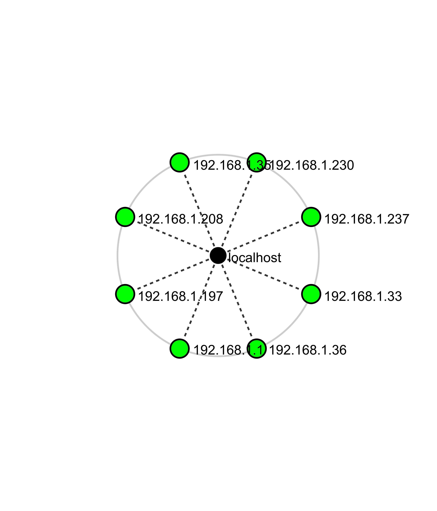

# PM5 — Zenmap Based Network Scanning

### *LAN Subnet Reconnaissance, Ping Sweeps & Topology Mapping*
**Networkwalks Cybersecurity Internship — Week 2 Practical Module**

[](https://nmap.org/)
[](https://nmap.org/zenmap/)
[](#task-answers--practical-breakdown)
[](#task-3--5-live-hosts-inventory)

---

## Overview

This module covers the execution of **Module PM5** of the Networkwalks Cybersecurity Internship: Local Area Network (LAN) reconnaissance and active host discovery using the **Zenmap** graphical interface powered by **Nmap 7.993**.

* **Target Subnet:** `192.168.1.0/24` (Subnet mask `255.255.255.0`)
* **Default Gateway:** `192.168.1.1` (Syrotech Networks)
* **Local Auditing Host:** `192.168.1.36`
* **Scan Profile:** `Ping scan` (`nmap -sn 192.168.1.0/24`)
* **Scan Results:** 256 IP addresses scanned, 8 hosts active in 11.43 seconds.

---

## Visual Topology

<p align="center">
  
</p>
<p align="center"><em>Figure 1: Zenmap radial topology mapping localhost (192.168.1.36) to all 8 discovered LAN hosts.</em></p>

---

## Task Answers & Practical Breakdown

### Task 2: Local IP Address and LAN Subnet
* **Local IPv4 Address:** `192.168.1.36`
* **Subnet Mask:** `255.255.255.0` (`/24`)
* **LAN Subnet:** `192.168.1.0/24`
* **Default Gateway:** `192.168.1.1`

### Task 3 & 5: Live Hosts Inventory
A total of **8 hosts** were discovered active on the network:

1. `192.168.1.1` (Default Gateway)
2. `192.168.1.33`
3. `192.168.1.35`
4. `192.168.1.36` (Local Host / Auditing Machine)
5. `192.168.1.197`
6. `192.168.1.208`
7. `192.168.1.230`
8. `192.168.1.237`

### Task 4: Total Number of Live Hosts
* **Total Hosts Up:** **8**

### Task 6: Hardware MAC Addresses
| IP Address | MAC Address | Discovery Source / Vendor |
|---|---|---|
| `192.168.1.1` | `54:47:E8:A6:B2:D3` | Zenmap output (Syrotech Networks.) |
| `192.168.1.33` | `5A:5A:02:5B:74:8D` | Zenmap output |
| `192.168.1.35` | `C6:BC:B3:DD:A7:B3` | Zenmap output |
| `192.168.1.36` | `B8:F7:75:AB:8C:2C` | Windows `ipconfig /all` |
| `192.168.1.197` | `5A:5A:00:DE:4F:CB` | Zenmap output |
| `192.168.1.208` | `5A:5A:00:DE:49:93` | Zenmap output |
| `192.168.1.230` | `5A:5A:00:DE:49:9D` | Zenmap output |
| `192.168.1.237` | `5A:5A:00:DE:49:BD` | Zenmap output |

---

## Evidence Gallery

| Evidence | Description | Thumbnail |
|:---:|---|:---:|
| **Evidence 1** | Zenmap Ping Scan target subnet and discovered host list | [View](images/evidence-1-ping-scan-overview.png) |
| **Evidence 2** | Scan completion summary (256 scanned, 8 up, 11.43s) | [View](images/evidence-2-scan-summary.png) |
| **Evidence 3** | Selected localhost (192.168.1.36) host details | [View](images/evidence-3-localhost-selection.png) |
| **Evidence 4** | Zenmap radial topology layout | [View](images/evidence-4-topology-layout.png) |
| **Evidence 5** | Detailed ring topology visualization | [View](images/evidence-5-topology-detail.png) |

---

## Automation Utility

To execute an automated ping sweep from the command line:

```bash
chmod +x scripts/ping_sweep.sh
./scripts/ping_sweep.sh 192.168.1.0/24
```

---

## Included Artifacts

* 📄 **Official Submission PDF:** [PM5_Task_Answers_and_Evidence_RITHISH_SP.pdf](reports/PM5_Task_Answers_and_Evidence_RITHISH_SP.pdf)
* 📄 **Zenmap Topology Export PDF:** [topology.pdf](reports/topology.pdf)
* 📄 **Raw CLI Output Log:** [zenmap-ping-scan-output.txt](zenmap-ping-scan-output.txt)
* 📜 **Automated Bash Script:** [scripts/ping_sweep.sh](scripts/ping_sweep.sh)
