# Information Gathering, Footprinting & Network Scanning

### *Passive & Active Reconnaissance Suite: Web Application Profiling & Zenmap LAN Discovery*
**Networkwalks Cybersecurity Internship — Week 2 Project Module**

[](https://nmap.org/)
[](https://nmap.org/zenmap/)
[](https://www.kali.org/)
[](#1-executive-summary)
[](#author--internship-information)

---

## Visual Overview

<p align="center">
  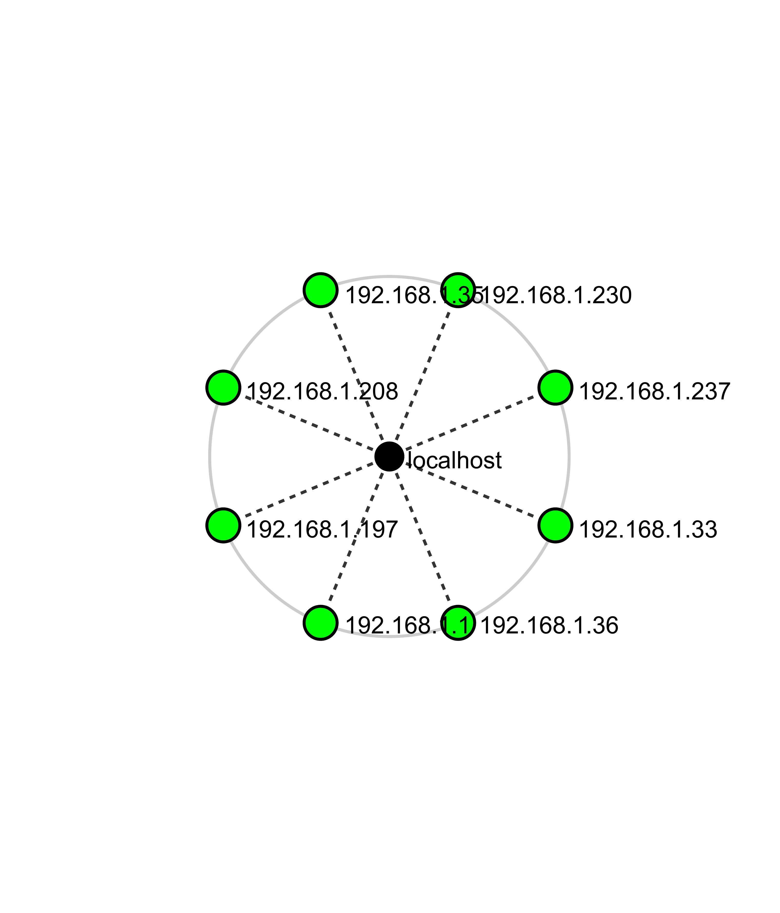
  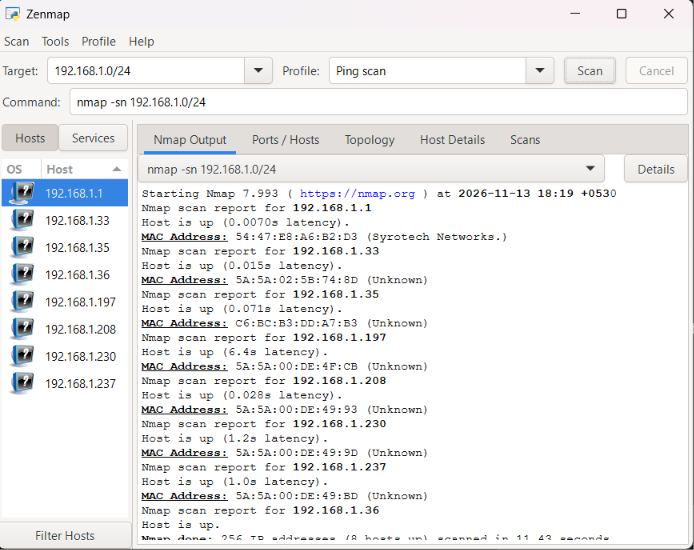
</p>
<p align="center">
  <em>Figure 1: Left: Zenmap circular network topology mapping 8 live LAN hosts. Right: Zenmap Nmap Ping sweep output across 192.168.1.0/24.</em>
</p>

---

## 1. Executive Summary

During **Week 2** of the **Networkwalks Cybersecurity Internship**, practical reconnaissance and network discovery operations were executed across two fundamental cybersecurity disciplines:

1. **PM1 — External Domain & Web Application Footprinting**:
   Comprehensive passive and active information gathering conducted against target domain `networkwalks.com` using industry-standard penetration testing tools: **WHOIS**, **WhatWeb**, **nslookup**, **cURL**, **WAFW00F**, and **DNSRecon**. The objective was to map public attack surfaces, registrar intelligence, authoritative DNS infrastructures, application software stacks, cache hierarchies, and Web Application Firewall (WAF) defensive protections.

2. **PM5 — Local Area Network (LAN) Reconnaissance & Host Discovery**:
   Layer 2 and Layer 3 internal network enumeration conducted on subnet `192.168.1.0/24` using **Zenmap / Nmap 7.993**. Utilizing ICMP echo requests and ARP ping sweeps (`-sn`), the assessment identified 8 active live hosts, mapped hardware MAC addresses and vendor profiles, analyzed routing boundaries, and modeled the internal topology graph.

---

## 2. Assessment Targets & Environmental Context

| Parameter | External Reconnaissance (PM1) | Internal LAN Discovery (PM5) |
|---|---|---|
| **Target Scope** | `networkwalks.com` | `192.168.1.0/24` (Class C Private Subnet) |
| **Resolved / Gateway IP** | `192.232.216.135` | Gateway: `192.168.1.1` (Syrotech Networks) |
| **Assessment Platform** | Kali Linux Security Workstation | Windows 11 Workstation (`192.168.1.36`) |
| **Primary Methodologies** | OSINT, DNS Enumeration, HTTP Banner Grabbing, WAF Detection | ARP Sweep, ICMP Ping Scan, Topology Mapping |
| **Core Utilities** | WHOIS, WhatWeb, nslookup, cURL, WAFW00F, DNSRecon | Zenmap GUI, Nmap 7.993 Engine |

---

## 3. Module PM1 — Web Application & Domain Footprinting

### Tool 1: WHOIS Domain Intelligence & Registration Profiling

WHOIS querying provides foundational open-source intelligence (OSINT) detailing domain ownership, registration life cycle, and authoritative administrative control.

```bash
whois networkwalks.com
```

<p align="center">
  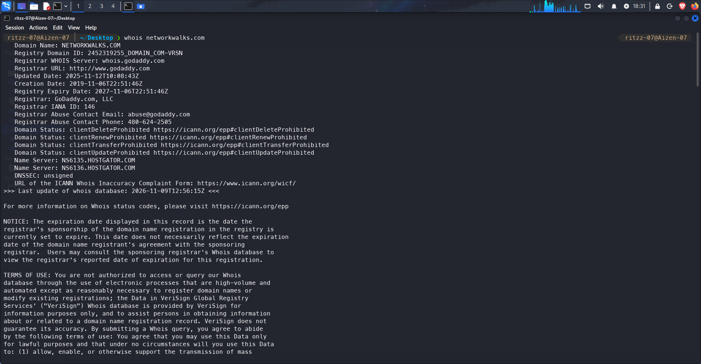
</p>
<p align="center"><em>Figure 2: Empirical WHOIS record output for networkwalks.com.</em></p>

#### Key Discoveries & Findings:
* **Registrar:** `GoDaddy.com, LLC` (IANA ID: `146`)
* **Domain Registration Date:** `2019-11-06T22:51:46Z`
* **Domain Expiration Date:** `2027-11-06T22:51:46Z` (Active registration secured through 2027)
* **Authoritative Name Servers:** `NS6135.HOSTGATOR.COM`, `NS6136.HOSTGATOR.COM`
* **Registrant Privacy:** Active WHOIS privacy protection through `Domains By Proxy, LLC` (Tempe, Arizona, US). Registrant PII (Personal Identifiable Information) is shielded from direct public harvesting.
* **Domain Status:** `clientTransferProhibited`, `clientUpdateProhibited`, `clientRenewProhibited`, `clientDeleteProhibited` (EPP protection flags mitigating unauthorized hijacking).

📄 **Raw Output Log:** [whois-output.txt](PM1-footprinting/tool1-whois/whois-output.txt)

---

### Tool 2: WhatWeb Next-Generation Web Fingerprinting

WhatWeb inspects HTTP responses, cookies, script tags, and HTML headers to determine underlying technology stacks, Content Management Systems (CMS), and framework libraries.

```bash
whatweb networkwalks.com
```

<p align="center">
  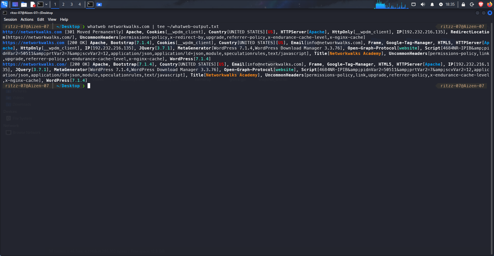
</p>
<p align="center"><em>Figure 3: WhatWeb technology fingerprinting output.</em></p>

#### Key Discoveries & Findings:
* **HTTP Redirect Flow:** `http://networkwalks.com` redirects via `301 Moved Permanently` to `https://networkwalks.com/` enforcing SSL/TLS encryption.
* **Content Management System (CMS):** `WordPress 7.1.4`
* **Web Server Engine:** `Apache`
* **Frontend Frameworks:** `Bootstrap 7.1.4`, `jQuery 3.7.1`
* **Active Plugins / Components:** `WordPress Download Manager (WPDM) 3.3.76`
* **Analytics & Tagging:** `Google-Tag-Manager`
* **Target IP Address:** `192.232.216.135` (United States)
* **Session Cookies:** `__wpdm_client` (flagged with `HttpOnly` to protect against Cross-Site Scripting cookie theft).

📄 **Raw Output Log:** [whatweb-output.txt](PM1-footprinting/tool2-whatweb/whatweb-output.txt)

---

### Tool 3: nslookup Authoritative & Non-Authoritative DNS Querying

`nslookup` queries local and upstream Domain Name System (DNS) servers to resolve hostnames to IP addresses.

```bash
nslookup networkwalks.com
```

<p align="center">
  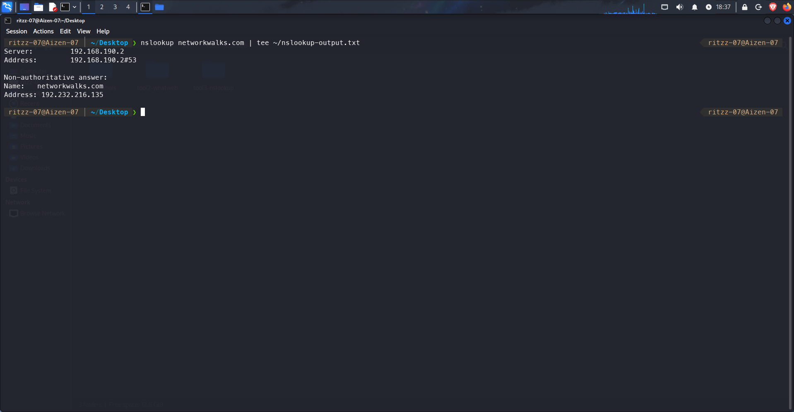
</p>
<p align="center"><em>Figure 4: nslookup DNS resolution output.</em></p>

#### Key Discoveries & Findings:
* **Local Recursive Resolver:** `192.168.190.2:53`
* **Resolution Type:** Non-authoritative answer (retrieved from resolver cache)
* **Resolved Canonical IPv4 Address:** `192.232.216.135`
* **Relevance:** Confirms destination IP for subsequent network-layer probes and active service mapping.

📄 **Raw Output Log:** [nslookup-output.txt](PM1-footprinting/tool3-nslookup/nslookup-output.txt)

---

### Tool 4: cURL HTTP Header Inspection & Banner Grabbing

cURL was executed with `-I` (`--head`) to capture HTTP response headers without downloading the full document body.

```bash
curl -I https://networkwalks.com
```

<p align="center">
  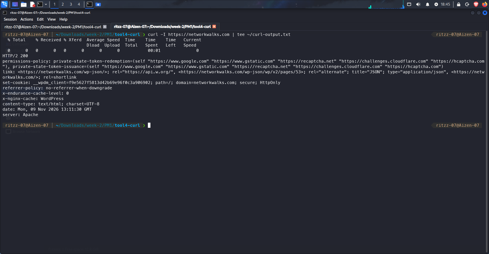
</p>
<p align="center"><em>Figure 5: cURL HTTP response headers.</em></p>

#### Key Discoveries & Findings:
* **Protocol & Status Code:** `HTTP/2 200`
* **Server Banner:** `server: Apache`
* **Caching Architecture:** Multi-tier caching evident via `x-nginx-cache: WordPress` and `x-endurance-cache-level: 0`. This indicates an Nginx reverse proxy fronting the backend Apache instance.
* **Security Headers & Cookies:**
  * `set-cookie: __wpdm_client=...; path=/; domain=networkwalks.com; secure; HttpOnly`
  * `permissions-policy: private-state-token-redemption=...`
  * `referrer-policy: no-referrer-when-downgrade`

📄 **Raw Output Log:** [curl-output.txt](PM1-footprinting/tool4-curl/curl-output.txt)

---

### Tool 5: WAFW00F Web Application Firewall Fingerprinting

WAFW00F sends algorithmic HTTP requests, inspects status codes, and analyzes response bodies to detect and identify Web Application Firewalls protecting web assets.

```bash
wafw00f https://networkwalks.com
```

<p align="center">
  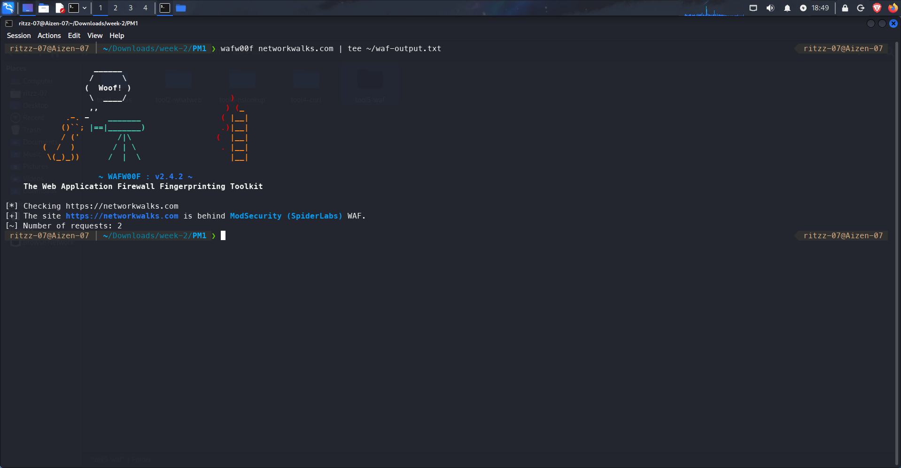
</p>
<p align="center"><em>Figure 6: WAFW00F ModSecurity detection output.</em></p>

#### Key Discoveries & Findings:
* **Detected WAF:** **`ModSecurity (SpiderLabs)`**
* **Requests Sent:** 2 detection probes
* **Operational Significance:** ModSecurity is an open-source, signature- and rule-based WAF (often integrated with the OWASP Core Rule Set). Security testers must craft payloads that avoid known signatures and SQLi/XSS rule heuristics when assessing this endpoint.

📄 **Raw Output Log:** [waf-output.txt](PM1-footprinting/tool5-waf/waf-output.txt)

---

### Tool 6: DNSRecon Comprehensive DNS Record Enumeration

DNSRecon performs deep zone enumeration, querying SOA, NS, MX, TXT (SPF), and SRV records to discover hidden hosts and services.

```bash
dnsrecon -d networkwalks.com
```

<p align="center">
  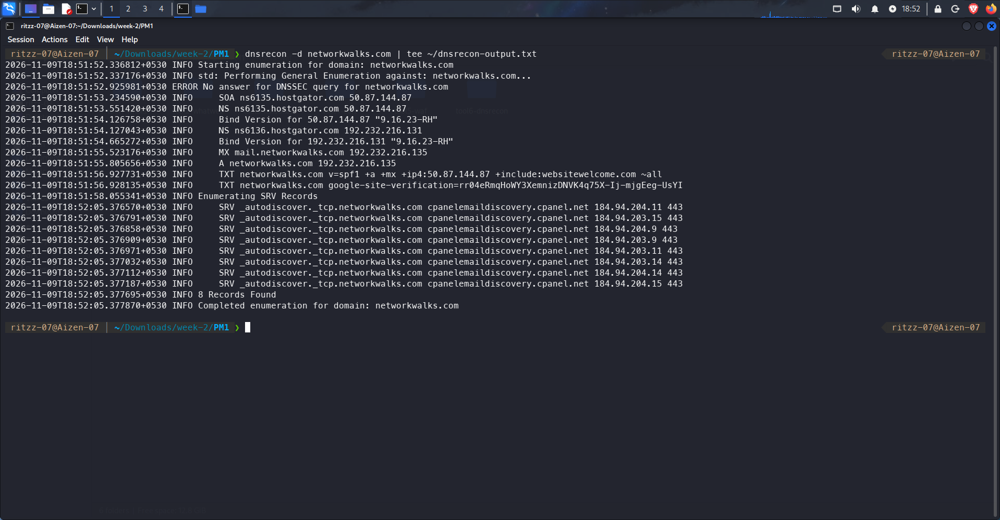
</p>
<p align="center"><em>Figure 7: DNSRecon enumeration and service discovery.</em></p>

#### Key Discoveries & Findings:
* **DNSSEC Status:** No answer for DNSSEC query (unsigned domain zone).
* **Start of Authority (SOA):** `ns6135.hostgator.com` (IP: `50.87.144.87`)
* **Authoritative Nameservers:**
  * `ns6135.hostgator.com` (`50.87.144.87`) — BIND Version: `9.16.23-RH`
  * `ns6136.hostgator.com` (`192.232.216.131`) — BIND Version: `9.16.23-RH`
* **Mail Exchange (MX):** `mail.networkwalks.com` (`192.232.216.135`)
* **Host Address (A):** `networkwalks.com` -> `192.232.216.135`
* **Sender Policy Framework (TXT SPF):**
  `v=spf1 +a +mx +ip4:50.87.144.87 +include:websitewelcome.com ~all`
  *(Defines authorized outbound mail servers to prevent domain spoofing).*
* **Site Verification (TXT):** Google site verification token recorded.
* **Service Records (SRV):** 8 autodiscover records identified pointing to `cpanelemaildiscovery.cpanel.net:443` across IP block `184.94.203.x / 184.94.204.x`.

📄 **Raw Output Log:** [dnsrecon-output.txt](PM1-footprinting/tool6-dnsrecon/dnsrecon-output.txt)

---

## 4. Module PM5 — Zenmap Local Network Reconnaissance & Host Discovery

### Practical Overview

The objective of Module PM5 was to discover all active devices on the local area network (LAN), extract their hardware Media Access Control (MAC) addresses, determine latency, and visualize the broadcast topology.

* **Auditing Tool:** Zenmap GUI / Nmap 7.993
* **Scan Profile:** `Ping scan`
* **Scan Command:** `nmap -sn 192.168.1.0/24`
* **Local Host Machine:** IP `192.168.1.36` (Subnet mask `255.255.255.0`, Gateway `192.168.1.1`)
* **Scan Metrics:** **256 IP addresses scanned, 8 live hosts discovered in 11.43 seconds.**

---

### Discovered Live Hosts Inventory & MAC Addressing

| # | IP Address | MAC Address | Hardware Vendor / Interface Source | Latency | Device Role |
|:---:|---|---|---|:---:|---|
| **1** | `192.168.1.1` | `54:47:E8:A6:B2:D3` | Syrotech Networks. | 0.0070s | Default LAN Gateway / Router |
| **2** | `192.168.1.33` | `5A:5A:02:5B:74:8D` | Unknown (Private / Randomized) | 0.0150s | Active LAN Client / Mobile Device |
| **3** | `192.168.1.35` | `C6:BC:B3:DD:A7:B3` | Unknown (Private / Randomized) | 0.0710s | Active LAN Client / Workstation |
| **4** | `192.168.1.36` | `B8:F7:75:AB:8C:2C` | Windows `ipconfig /all` | 0.0000s | Scanning Host (Local Workstation) |
| **5** | `192.168.1.197` | `5A:5A:00:DE:4F:CB` | Unknown (Private / Randomized) | 6.4000s | High Latency Client / Smart Device |
| **6** | `192.168.1.208` | `5A:5A:00:DE:49:93` | Unknown (Private / Randomized) | 0.0280s | Active LAN Client |
| **7** | `192.168.1.230` | `5A:5A:00:DE:49:9D` | Unknown (Private / Randomized) | 1.2000s | Active LAN Client |
| **8** | `192.168.1.237` | `5A:5A:00:DE:49:BD` | Unknown (Private / Randomized) | 1.0000s | Active LAN Client |

> [!NOTE]
> On the scanning workstation (`192.168.1.36`), Nmap does not send ARP frames to itself; thus, its MAC address (`B8:F7:75:AB:8C:2C`) was verified via the native host operating system command `ipconfig /all`. All other 7 MAC addresses were resolved over Layer 2 ARP queries by Nmap.

---

### Empirical Verification & Visual Evidence

#### Evidence 1: Zenmap Ping Scan & Discovered Host List
Zenmap interface demonstrating the target subnet `192.168.1.0/24`, Ping scan profile, and real-time host discovery.

<p align="center">
  
</p>
<p align="center"><em>Figure 8: Zenmap Ping Scan execution showing target subnet and discovered hosts.</em></p>

---

#### Evidence 2: Scan Completion Summary
Scan execution summary confirming 256 IP addresses evaluated, 8 hosts online, and total execution time of 11.43 seconds.

<p align="center">
  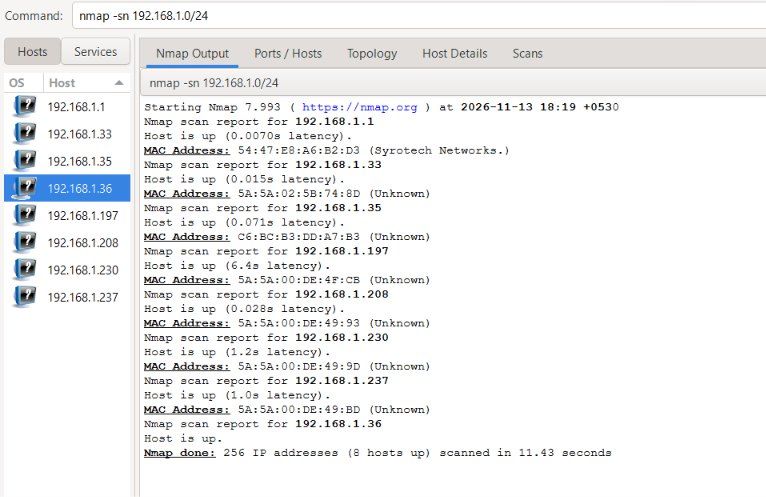
</p>
<p align="center"><em>Figure 9: Scan metrics: 256 addresses scanned, 8 hosts up in 11.43 seconds.</em></p>

---

#### Evidence 3: Localhost Node Selection
Inspection of host details and verification of the local scanning node `192.168.1.36`.

<p align="center">
  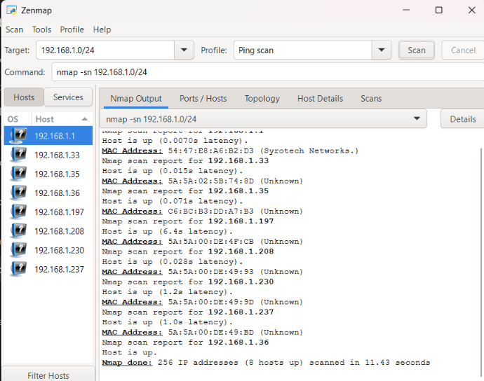
</p>
<p align="center"><em>Figure 10: Selected local host 192.168.1.36 within Zenmap host view.</em></p>

---

#### Evidence 4 & 5: Radial Topology Visualizations
Zenmap topology graph demonstrating localhost at the center with radial links to all 8 discovered endpoints.

<p align="center">
  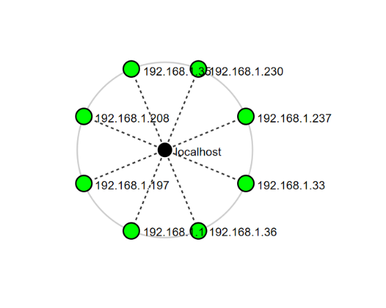
  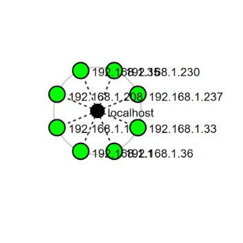
</p>
<p align="center"><em>Figure 11: Zenmap radial topology mapping localhost and surrounding subnet nodes.</em></p>

📄 **Official Submission PDF:** [PM5_Task_Answers_and_Evidence_RITHISH_SP.pdf](PM5-zenmap-network-scanning/reports/PM5_Task_Answers_and_Evidence_RITHISH_SP.pdf)  
📄 **Vector Topology Diagram:** [topology.pdf](PM5-zenmap-network-scanning/reports/topology.pdf)  
📄 **Raw Scan Output:** [zenmap-ping-scan-output.txt](PM5-zenmap-network-scanning/zenmap-ping-scan-output.txt)

---

## 5. Security Analysis & Hardening Recommendations

### Threats Identified in Flat Subnets (`192.168.1.0/24`)

1. **Unrestricted Layer 2 Broadcast Exposure (ARP Spoofing / Poisoning):**
   * *Vulnerability:* Because all 8 devices reside in an unsegmented `/24` broadcast domain, any compromised client can broadcast gratuitous ARP replies, impersonating default gateway `192.168.1.1` and conducting Man-In-The-Middle (MITM) traffic interception.
   * *Mitigation:* Implement **Dynamic ARP Inspection (DAI)** and **DHCP Snooping** on managed network switches.

2. **Absence of VLAN Segmentation:**
   * *Vulnerability:* Personal devices, IoT endpoints (`192.168.1.197` with high latency), and administrative workstations coexist on the same segment without firewall boundaries.
   * *Mitigation:* Segment the network into functional VLANs: Management (VLAN 10), Workstations (VLAN 20), IoT Devices (VLAN 30), and Guest Network (VLAN 40) with inter-VLAN access control lists (ACLs).

3. **MAC Address Randomization vs. Port Security:**
   * *Vulnerability:* Several endpoints feature randomized MAC prefixes (`5A:5A:...`). While beneficial for mobile privacy on public networks, it prevents static MAC-based port security enforcement in corporate environments.
   * *Mitigation:* Deploy **IEEE 802.1X Network Access Control (NAC)** with RADIUS authentication for cryptographic identity validation.

---

## 6. Practical Automation Tool

To automate rapid subnet discovery and MAC resolution in future assessments, a lightweight Bash discovery utility was built:

* **Script:** [`week2/PM5-zenmap-network-scanning/scripts/ping_sweep.sh`](PM5-zenmap-network-scanning/scripts/ping_sweep.sh)
* **Execution:**
  ```bash
  chmod +x week2/PM5-zenmap-network-scanning/scripts/ping_sweep.sh
  ./week2/PM5-zenmap-network-scanning/scripts/ping_sweep.sh 192.168.1.0/24
  ```

---

## 7. Directory Structure

```
week2/
├── README.md                                          # Master Week 2 Technical Runbook & Documentation
├── PM1-footprinting/                                  # Passive & Active OSINT / Footprinting Suite
│   ├── tool1-whois/
│   │   ├── whois-output.txt                           # Raw WHOIS domain registration record
│   │   └── whois.png                                  # Empirical CLI screenshot
│   ├── tool2-whatweb/
│   │   ├── whatweb-output.txt                         # CMS & web server fingerprint log
│   │   └── whatweb.png                                # Empirical CLI screenshot
│   ├── tool3-nslookup/
│   │   ├── nslookup-output.txt                        # DNS A record resolution log
│   │   └── nslookup.png                               # Empirical CLI screenshot
│   ├── tool4-curl/
│   │   ├── curl-output.txt                            # HTTP response headers & cookie dump
│   │   └── curl.png                                   # Empirical CLI screenshot
│   ├── tool5-waf/
│   │   ├── waf-output.txt                             # WAFW00F ModSecurity detection log
│   │   └── waf.png                                    # Empirical CLI screenshot
│   └── tool6-dnsrecon/
│       ├── dnsrecon-output.txt                        # Full DNS zone & SRV record enumeration
│       └── dnsrecon.png                               # Empirical CLI screenshot
└── PM5-zenmap-network-scanning/                       # Internal LAN Reconnaissance & Host Discovery
    ├── README.md                                      # PM5 dedicated module report
    ├── zenmap-ping-scan-output.txt                    # Formatted Nmap ping sweep log (8 hosts)
    ├── scripts/
    │   └── ping_sweep.sh                              # Automated LAN host discovery & ARP tool
    ├── reports/
    │   ├── PM5_Task_Answers_and_Evidence_RITHISH_SP.pdf # Practical answers & evidence PDF
    │   └── topology.pdf                               # Exported Zenmap vector topology PDF
    └── images/
        ├── evidence-1-ping-scan-overview.png          # Zenmap ping sweep target & output
        ├── evidence-2-scan-summary.png                # Execution metrics & host count
        ├── evidence-3-localhost-selection.png         # Selected localhost (192.168.1.36) view
        ├── evidence-4-topology-layout.png             # Initial topology graph layout
        ├── evidence-5-topology-detail.png             # Adjusted ring topology graph
        └── topology-diagram.png                       # High-resolution rendered topology map
```

---

## Author & Internship Information

* **Author:** Rithish S P
* **GitHub:** [@Ritzz-09](https://github.com/Ritzz-09)
* **Program:** Networkwalks Cybersecurity Internship
* **Repository:** [Networkwalks-Internship](https://github.com/Ritzz-09/Networkwalks-Internship)
