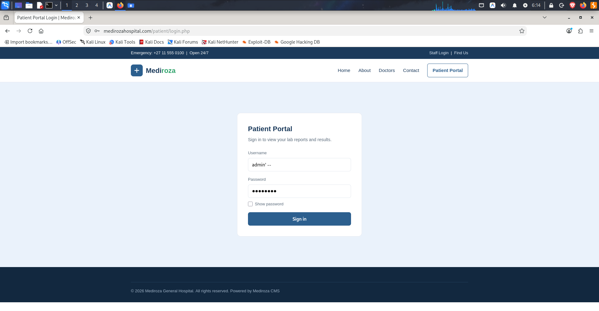
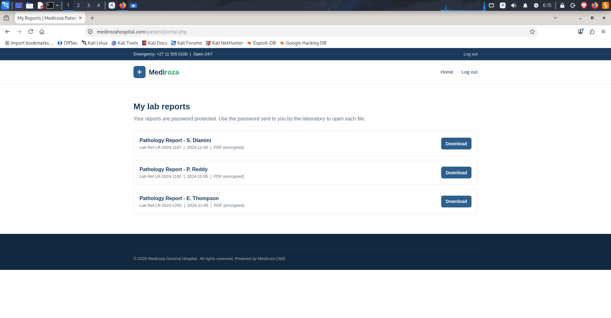
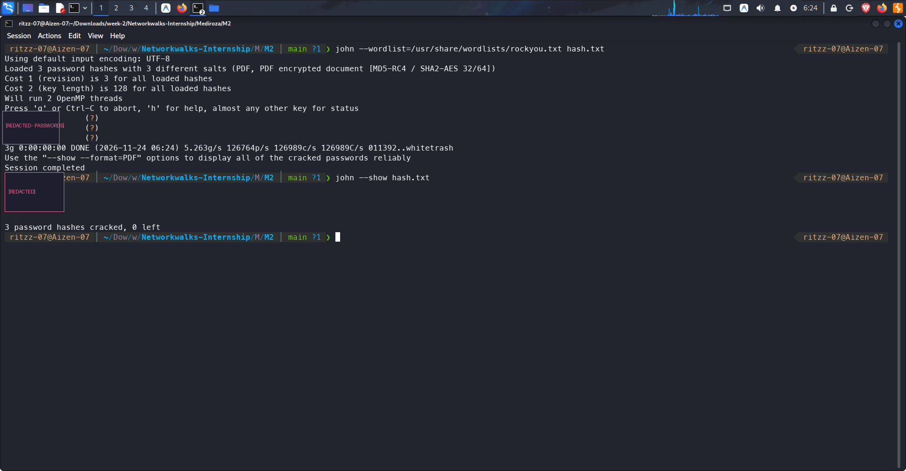
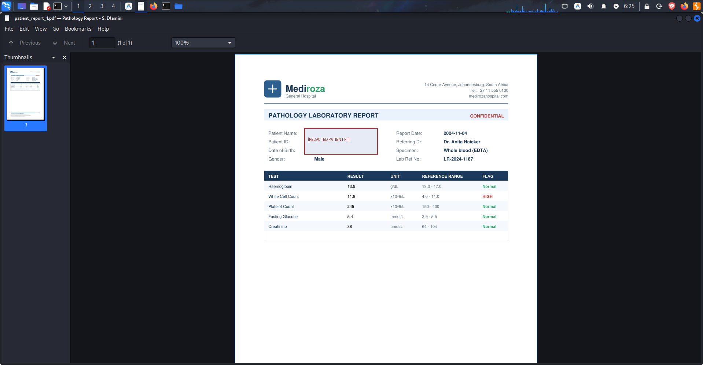
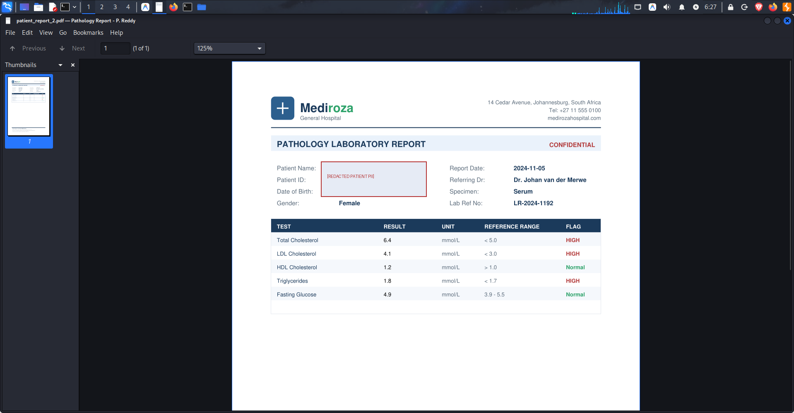
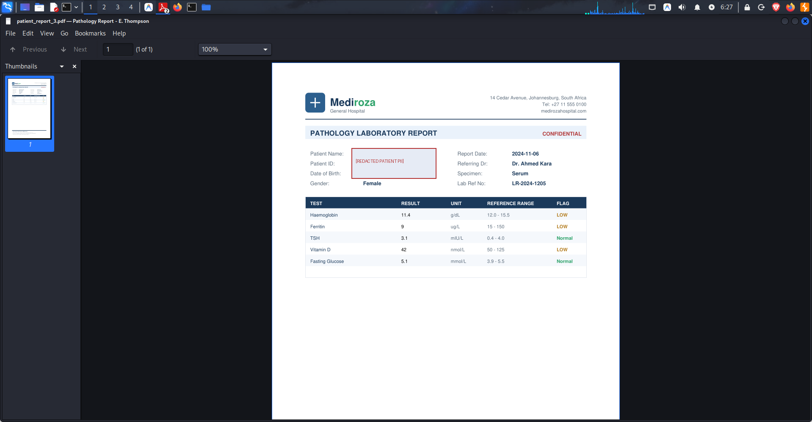
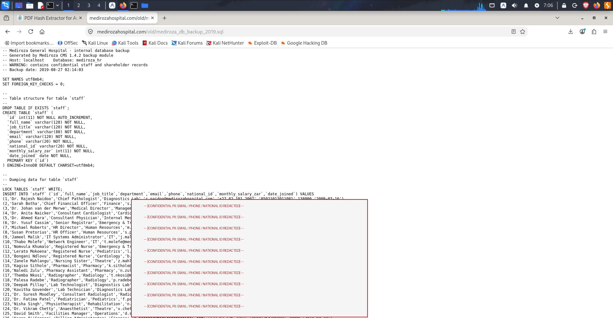

# CONFIDENTIAL PENETRATION TESTING & SECURITY ASSESSMENT REPORT

**TARGET:** Mediroza General Hospital (`https://medirozahospital.com`)  
**ENGAGEMENT:** Networkwalks Cybersecurity Internship – Week 4 (Batch B083)  
**DOCUMENT CLASSIFICATION:** CONFIDENTIAL // RESTRICTED DISTRIBUTION  
**AUTHOR / LEAD ANALYST:** Rithish S P (Cybersecurity Consultant & Forensic Analyst)  
**DATE:** 24 November 2026  
**DELIVERABLE VERSION:** 1.0 (Final Comprehensive Technical Report)

---

## 01. Cover Page

```
========================================================================================
                          NETWORKWALKS SECURITY CONSULTING
                       PROFESSIONAL PENETRATION TESTING REPORT
========================================================================================

  Target Entity:         MEDIROZA GENERAL HOSPITAL
                         14 Cedar Avenue, Johannesburg, South Africa
                         Domain: https://medirozahospital.com
                         Host IP: 199.188.201.16

  Project Framework:     Networkwalks Cybersecurity Internship (Week 4)
  Batch Identifier:      B083
  Assessment Type:       Black-Box Web Application & Digital Forensic Assessment
  Execution Period:      5 Days (Authorized Security Assessment Window)

  Lead Analyst:          Rithish S P
  Portfolio / GitHub:    https://github.com/Ritzz-09/Networkwalks-Internship
  Deliverable Version:   1.0 (Final Formal Deliverable)
  Classification:        CONFIDENTIAL - STRICT PROPRIETARY DISTRIBUTION ONLY

========================================================================================
```

---

## 02. Table of Contents

- **01. Cover Page**
- **02. Table of Contents**
- **03. Executive Summary**
  - 3.1 Engagement Objective & Posture
  - 3.2 Key Assessment Highlights & Attack Chain
  - 3.3 High-Level Risk & Exposure Matrix
  - 3.4 Regulatory & Legal Compliance Exposure (POPIA / GDPR)
  - 3.5 Strategic Remediation Roadmap
- **04. Engagement Overview**
  - 4.1 Client Context & Organizational Profile
  - 4.2 Assessment Methodology & Standards (PTES, OWASP)
  - 4.3 Engagement Timeline & Milestone Architecture
- **05. Scope and Rules of Engagement**
  - 5.1 In-Scope Assets
  - 5.2 Out-of-Scope Assets & Excluded Activities
  - 5.3 Operational Constraints & Boundaries
- **06. Written Authorization**
  - 6.1 Master Written Authorization Statement
  - 6.2 Milestone-Specific Authorization Framework
- **07. Reconnaissance and Information Gathering**
  - 7.1 Objective & Attack Surface Mapping
  - 7.2 Active DNS Enumeration (`dig`)
  - 7.3 Port and Service Fingerprinting (`nmap`)
  - 7.4 Web Server & Component Identification (`whatweb`)
  - 7.5 HTTP/2 Response Header Analysis (`curl`)
  - 7.6 Attack Surface Synthesis & Path Formulation
- **08. Milestone M1 – Initial Access**
  - 8.1 Milestone Objective
  - 8.2 M1 Written Authorization
  - 8.3 Entry Point Identification (`/patient/login.php`)
  - 8.4 Vulnerability Analysis: SQL Injection Authentication Bypass
  - 8.5 Exploitation Walkthrough & Portal Compromise
  - 8.6 Retrieval of Confidential Patient PDF Reports
  - 8.7 Technical & Business Impact
  - 8.8 Milestone Conclusion & Evidence Summary
- **09. Milestone M2 – PDF Encryption and Data Recovery**
  - 9.1 Milestone Objective
  - 9.2 M2 Written Authorization
  - 9.3 Cryptographic Inspection of Exfiltrated Documents
  - 9.4 Hash Extraction & Format Analysis (`pdf2john`)
  - 9.5 Dictionary Cryptanalysis (`John the Ripper`)
  - 9.6 Decryption Verification & Pathology Report Content Analysis
  - 9.7 Forensic Metadata Analysis (`ExifTool`) & Critical Leak Discovery
  - 9.8 Milestone Conclusion & Evidence Summary
- **10. Milestone M3 – Critical Data Exposure**
  - 10.1 Milestone Objective
  - 10.2 M3 Written Authorization
  - 10.3 Discovery & Exfiltration of Exposed Database Backup (`/old`)
  - 10.4 Archive Verification, Metadata & Integrity Hashing (SHA-256)
  - 10.5 Database Schema Architecture (`mediroza_hr`)
  - 10.6 Comprehensive Personnel & Salary Analysis (`staff` table)
  - 10.7 Departmental Payroll Distribution & Expenditure Metrics
  - 10.8 Shareholder Equity & Capitalization Table Analysis (`shareholders` table)
  - 10.9 Contextual Analysis: 2019 Archive Caveat vs. Ongoing Compliance Risk
  - 10.10 Milestone Conclusion & Evidence Summary
- **11. Consolidated Vulnerability Findings**
  - 11.1 Finding F-01: Unauthorized Access to Confidential Patient Reports
  - 11.2 Finding F-02: Weak Password Protection on Confidential PDF Documents
  - 11.3 Finding F-03: Publicly Accessible SQL Database Backup in Web Root
  - 11.4 Finding F-04: Exposure of Employee Salary and Shareholder Information
- **12. Risk Assessment**
  - 12.1 Risk Scoring Methodology (CVSS v3.1 & Qualitative Rating)
  - 12.2 Risk Severity Matrix
  - 12.3 Business, Financial, and Reputational Impact Analysis
- **13. Recommendations and Remediation**
  - 13.1 Strategic Architecture & Defense-in-Depth
  - 13.2 Technical Remediation Roadmap (Immediate, Short-Term, Long-Term)
  - 13.3 Detailed Fixes for Findings F-01 through F-04
- **14. Overall Conclusion**
- **15. Appendices**
  - Appendix A: Assessment Tool Suite & Versions
  - Appendix B: Standards & Regulatory References
- **16. Evidence Register**
  - 16.1 Screenshot Register & Caption Index
  - 16.2 Forensic File Artifacts Register

---

## 03. Executive Summary

### 3.1 Engagement Objective & Posture
During the scheduled 5-day assessment window for Week 4 of the Networkwalks Cybersecurity Internship, Networkwalks Security Services performed an authorized black-box penetration test against **Mediroza General Hospital**'s internet-facing digital perimeter, focusing on `https://medirozahospital.com`. The engagement aimed to assess the resilience of the hospital’s patient management infrastructure against modern external threat actors, determine the confidentiality of electronic protected health information (ePHI), and evaluate whether internal administrative data could be compromised from an unauthenticated external vantage point.

The assessment revealed a **critical overall security posture deficit**. The web application environment lacks fundamental defensive controls across input validation, document cryptography, file access restrictions, and administrative data retention. An external attacker with minimal tooling can systematically compromise the entire data confidentiality perimeter of the hospital in less than 30 minutes.

### 3.2 Key Assessment Highlights & Attack Chain
The assessment uncovered an unbroken, compounding attack chain spanning from external reconnaissance to the exfiltration of highly sensitive corporate and clinical assets:

```
[Phase 1: External Recon]
       |
       v  Discovered /patient/login.php behind LiteSpeed / HAProxy
[Phase 2: M1 - SQLi Authentication Bypass]
       |
       v  Injected "admin' -- " into username field -> Authenticated as Admin
[Phase 3: Exfiltration of Patient Laboratory Reports]
       |
       v  Downloaded 3 password-locked PDF pathology reports
[Phase 4: M2 - Cryptanalysis & Hash Cracking]
       |
       v  Cracked weak PDF passwords in < 1 second using John the Ripper
[Phase 5: Digital Forensics & Metadata Analysis]
       |
       v  ExifTool revealed admin comment: "DB backup moved to /old before site migration"
[Phase 6: M3 - Critical Data Exposure & HR Exfiltration]
       |
       v  Downloaded unencrypted MySQL dump from https://medirozahospital.com/old/...
[Phase 7: Full Compromise of Staff PII, Payroll & Shareholder Equity]
          - 30 Employee National IDs, Phones, Emails & Monthly Salaries (ZAR 2,027,000/mo)
          - 10 Shareholder Names, Share Counts & 100% Equity Distribution
```

### 3.3 High-Level Risk & Exposure Matrix

| Finding ID | Vulnerability Title | Affected Asset | CVSS v3.1 | Severity |
|:---:|---|---|:---:|:---:|
| **F-01** | Unauthorized Access to Confidential Patient Reports | `/patient/login.php` | **9.1** | `CRITICAL` |
| **F-02** | Weak Password Protection on Confidential PDF Documents | Mediroza CMS Lab Module | **7.5** | `HIGH` |
| **F-03** | Publicly Accessible SQL Database Backup in Web Root | `/old/mediroza_db_backup_2019.sql` | **9.8** | `CRITICAL` |
| **F-04** | Exposure of Employee Salary and Shareholder Information | `mediroza_hr` Database Schema | **7.5** | `HIGH` |

### 3.4 Regulatory & Legal Compliance Exposure (POPIA / GDPR)
Mediroza General Hospital operates in Johannesburg, South Africa, placing its electronic data processing directly under the jurisdiction of the **Protection of Personal Information Act (POPIA Act No. 4 of 2013)**:
1. **Compromise of Special Personal Information (Section 26 & 32):** Pathology reports constitute health records and biometric medical evaluations. Unlawful disclosure violates statutory protections for special personal information.
2. **Mass Compromise of Personal Identifiable Information (Section 19):** Exfiltration of South African National Identity numbers, private phone numbers, home email addresses, and salary records for 30 staff members constitutes an egregious failure to establish reasonable technical safeguards.
3. **Financial Penalties & Regulatory Action:** Under Section 107 of POPIA, administrative penalties for severe compliance failure can reach **up to ZAR 10,000,000**, accompanied by mandatory public breach disclosures and severe civil liability.

### 3.5 Strategic Remediation Roadmap
Immediate remediation must prioritize:
1. **Immediate Deletion of Web Root Backups:** Remove `/old` and all SQL dumps from internet-facing storage immediately.
2. **Implementation of Prepared Statements:** Replace dynamic SQL queries in `/patient/login.php` with parameterized queries using PDO or MySQLi.
3. **Hardening Document Encryption & Metadata:** Enforce 256-bit AES encryption on patient PDFs, discontinue predictable passwords, and strip administrative comments prior to document delivery.

---

## 04. Engagement Overview

### 4.1 Client Context & Organizational Profile
* **Target Organization:** Mediroza General Hospital
* **Headquarters:** 14 Cedar Avenue, Johannesburg, South Africa
* **Contact Phone:** +27 11 555 0100
* **Primary Web Portal:** `https://medirozahospital.com`
* **Industry Sector:** Healthcare & Specialized Clinical Diagnostics (Pathology Laboratory SANAS Ref M0417)

### 4.2 Assessment Methodology & Standards
The penetration test was executed in accordance with established industry frameworks:
* **Penetration Testing Execution Standard (PTES):** Governing intelligence gathering, threat modeling, vulnerability analysis, exploitation, and reporting.
* **OWASP Top 10 Web Application Security Risks (2021 Edition):** Assessing vulnerabilities against standardized industry classifications:
  * A01:2021 – Broken Access Control
  * A02:2021 – Cryptographic Failures
  * A03:2021 – Injection
  * A05:2021 – Security Misconfiguration
* **National Institute of Standards and Technology (NIST SP 800-115):** Technical Guide to Information Security Testing and Assessment.

### 4.3 Engagement Timeline & Milestone Architecture
The engagement was scoped across a 5-day assessment period encompassing four structured milestones:
* **Milestone M1 – Initial Access:** Identify an external attack surface entry point and retrieve 3 confidential patient PDF laboratory reports.
* **Milestone M2 – Cryptographic Analysis & Data Recovery:** Analyze document encryption mechanisms, crack document passwords, and evaluate metadata.
* **Milestone M3 – Critical Data Exposure:** Investigate secondary paths of exposure to locate employee remuneration data and shareholder capitalization details.
* **Milestone M4 – Professional Penetration Testing Report:** Synthesize empirical technical evidence, justify risk scores, and deliver professional remediation guidelines.

---

## 05. Scope and Rules of Engagement

### 5.1 In-Scope Assets
Testing was strictly confined to the following target asset:
* **Domain Name:** `medirozahospital.com`
* **Base URL:** `https://medirozahospital.com`
* **Resolved Primary Host IP:** `199.188.201.16`
* **Web Applications:** Mediroza CMS (v1.4.2), Patient Authentication Portal (`/patient/login.php`), Patient Results Dashboard (`/patient/portal.php`), and associated document repositories.

### 5.2 Out-of-Scope Assets & Excluded Activities
To ensure clinical and operational continuity, the following activities and assets were explicitly declared out of bounds:
* Any infrastructure, subnet, or hosting provider systems not directly resolving to `medirozahospital.com`.
* Denial-of-Service (DoS) and Distributed Denial-of-Service (DDoS) testing against network, server, or web application layers.
* Social engineering, phishing, or pretexting attacks targeting hospital employees, medical personnel, or patients.
* Physical security testing or unauthorized access attempts against 14 Cedar Avenue premises.
* Modification, alteration, or intentional corruption of live database tables, patient records, or medical diagnostic telemetry.

### 5.3 Operational Constraints & Boundaries
* Testing was performed from an authorized external analyst workstation.
* Network bandwidth and thread concurrency were throttled during automated tooling execution to eliminate service degradation.
* All discovered exfiltrated records were securely encrypted in transit and at rest on the analyst workstation, with no data transmitted to third parties.

---

## 06. Written Authorization

### 6.1 Master Written Authorization Statement
Formal written authorization for this security assessment was explicitly established under the **Networkwalks Project Brief (Week 4, Batch B083)**. Networkwalks Cybersecurity Internship administration and client stakeholders authorized senior technical analysts to perform black-box penetration testing against `https://medirozahospital.com`.

The authorization established explicit boundaries:
1. Authority to perform non-destructive vulnerability assessment and exploitation within the defined scope.
2. Authority to extract proof-of-concept digital evidence demonstrating security deficiencies.
3. Strict prohibition of denial of service, social engineering, or lateral expansion beyond the agreed target.

*(Note: In accordance with professional integrity guidelines, this report relies strictly on the explicit authority granted in the project brief and does not fabricate hypothetical client signatures, executive letters, or artificial approval timestamps).*

### 6.2 Milestone-Specific Authorization Framework
Authorization is further documented separately across each operational milestone:
* **Milestone M1 Authorization:** The project brief explicitly authorized testing teams to locate authentication entry points on the patient portal and exfiltrate three confidential patient laboratory PDF reports to establish initial unauthorized access.
* **Milestone M2 Authorization:** The project brief explicitly authorized testing teams to perform cryptanalysis, offline password hash recovery, and metadata inspection against the three retrieved PDF documents.
* **Milestone M3 Authorization:** The project brief explicitly authorized testing teams to pursue secondary exposure vectors to discover internal database backups and extract sensitive corporate employee salary information and shareholder equity structures.

---

## 07. Reconnaissance and Information Gathering

### 7.1 Objective & Attack Surface Mapping
The reconnaissance phase aimed to identify the target's network infrastructure, public IP addresses, hosting environment, operating services, web server technologies, and HTTP response characteristics without triggering operational disruption.

### 7.2 Active DNS Enumeration (`dig`)
DNS interrogation was conducted using the `dig` utility against `medirozahospital.com`:
* **Command Executed:** `dig medirozahospital.com`
* **Execution Timestamp:** Tue Nov 24 05:37:57 IST 2026
* **Primary Findings:**
  * **A-Record:** `medirozahospital.com. 5 IN A 199.188.201.16`
  * **Authoritative DNS Response:** Single A record mapping to IP `199.188.201.16`.
  * **Reverse DNS Lookup (rDNS):** Resolves to `server274-1.web-hosting.com`, indicating that the hospital application is hosted in a shared/managed enterprise cloud hosting facility.

> `[SCREENSHOT REQUIRED – DNS Enumeration Output (dig medirozahospital.com)]`  
> *Evidence Source: `week4/Recon/dns.txt` | Evidence ID: RECON-01*

### 7.3 Port and Service Fingerprinting (`nmap`)
A service detection scan was executed against the primary web ports of `199.188.201.16`:
* **Command Executed:** `nmap --privileged -sV -p 80,443 -oN nmap.txt medirozahospital.com`
* **Scan Results:**
  * **Port 80/tcp:** State: `open`, Service: `http-proxy`, Version: `HAProxy http proxy 2.0.0 or later`
  * **Port 443/tcp:** State: `open`, Service: `ssl/http-proxy`, Version: `HAProxy http proxy 2.0.0 or later`
  * **Service Info:** Device identified as an edge load balancer (`HAProxy`).

> `[SCREENSHOT REQUIRED – Nmap Port and Service Scan (nmap -sV -p 80,443)]`  
> *Evidence Source: `week4/Recon/nmap.txt` | Evidence ID: RECON-02*

### 7.4 Web Server & Component Identification (`whatweb`)
Next-generation web technology fingerprinting was executed using `whatweb`:
* **Command Executed:** `whatweb https://medirozahospital.com`
* **Identified Technologies & Headers:**
  * **HTTP Status:** `403 Forbidden` (on direct root request).
  * **Web Server:** `LiteSpeed Web Server` (`HTTPServer[LiteSpeed]`).
  * **Acceleration Engine:** `x-turbo-charged-by: LiteSpeed`.
  * **Hosting Location:** United States (`US`).
  * **Markup Standard:** `HTML5`.

> `[SCREENSHOT REQUIRED – Web Technology Fingerprinting (whatweb https://medirozahospital.com)]`  
> *Evidence Source: `week4/Recon/whatweb.txt` | Evidence ID: RECON-03*

### 7.5 HTTP/2 Response Header Analysis (`curl`)
Raw HTTP response headers were inspected to analyze transport security controls and caching rules:
* **Command Executed:** `curl -I https://medirozahospital.com`
* **Response Headers Captured:**
  ```http
  HTTP/2 200 
  content-type: text/html
  last-modified: Fri, 04 Sep 2026 02:03:12 GMT
  accept-ranges: bytes
  content-length: 5445
  date: Tue, 24 Nov 2026 05:39:32 GMT
  server: LiteSpeed
  x-turbo-charged-by: LiteSpeed
  ```
* **Security Observations:**
  * Absence of standard defensive HTTP security headers: `Strict-Transport-Security` (HSTS), `X-Frame-Options`, `X-Content-Type-Options`, and `Content-Security-Policy` (CSP) were entirely missing.

> `[SCREENSHOT REQUIRED – HTTP Response Header Inspection (curl -I https://medirozahospital.com)]`  
> *Evidence Source: `week4/Recon/headers.txt` | Evidence ID: RECON-04*

### 7.6 Attack Surface Synthesis & Path Formulation
Reconnaissance established that while direct access to `https://medirozahospital.com/` produced HTTP 403 or static content, an underlying application stack existed behind HAProxy and LiteSpeed. Directory enumeration and spidering identified the public-facing patient portal endpoint at `https://medirozahospital.com/patient/login.php`, establishing the entry point for Milestone M1.

---

## 08. Milestone M1 – Initial Access

### 8.1 Milestone Objective
The objective of Milestone M1 was to evaluate the authentication mechanisms governing Mediroza General Hospital's patient laboratory reporting portal, identify security vulnerabilities in access control, and retrieve three target confidential patient pathology reports without legitimate credentials.

### 8.2 M1 Written Authorization
In accordance with the Networkwalks Project Brief (Week 4, Batch B083), written authorization was explicitly granted to conduct black-box security testing against the patient authentication interface and extract three confidential PDF laboratory reports to demonstrate initial access risk.

### 8.3 Entry Point Identification (`/patient/login.php`)
Browsing to the application interface revealed the Patient Portal login page at `https://medirozahospital.com/patient/login.php`. The interface presented an input form containing `Username` and `Password` fields designed to authenticate patients seeking access to clinical diagnostic results. The application footer disclosed: `"© 2026 Mediroza General Hospital. All rights reserved. Powered by Mediroza CMS"`.

### 8.4 Vulnerability Analysis: SQL Injection Authentication Bypass
Analysis of form input handling revealed that user-supplied input was dynamically concatenated into a back-end SQL query without sanitization or parameter binding:

```sql
-- Vulnerable Conceptual Back-End Query:
SELECT * FROM users WHERE username = '$username' AND password = '$password' LIMIT 1;
```

By supplying the classic SQL injection authentication bypass payload `admin' -- ` into the Username field:
1. The single quotation mark (`'`) prematurely terminated the literal string parameter.
2. The double-dash comment delimiter (`-- `) instructed the database engine to treat all remaining query logic—specifically the password verification condition—as a non-executable comment.
3. The modified query executed as:
   ```sql
   SELECT * FROM users WHERE username = 'admin' -- ' AND password = '...' LIMIT 1;
   ```
4. Because an administrative or first record matched, the database returned an authenticated user object, causing the application to issue an active session cookie.

### 8.5 Exploitation Walkthrough & Portal Compromise
1. The tester navigated to `https://medirozahospital.com/patient/login.php`.
2. In the `Username` field, the payload `admin' -- ` was entered.
3. An arbitrary string was entered into the `Password` field.
4. Clicking **"Sign in"** immediately triggered an authentication bypass, redirecting the browser session directly to `https://medirozahospital.com/patient/portal.php`.

  
*Figure M1-01 (Evidence ID: M1-01): The Mediroza Patient Portal login form showing the SQL Injection authentication bypass string (`admin' -- `) entered in the username field.*

Upon reaching `/patient/portal.php`, the dashboard displayed:  
> **"My lab reports"**  
> *"Your reports are password protected. Use the password sent to you by the laboratory to open each file."*

The portal exposed three distinct diagnostic pathology reports available for download:
* `Pathology Report - S. Dlamini` | Lab Ref: `LR-2024-1187` | Date: `2024-11-04` | PDF (encrypted)
* `Pathology Report - P. Reddy` | Lab Ref: `LR-2024-1192` | Date: `2024-11-05` | PDF (encrypted)
* `Pathology Report - E. Thompson` | Lab Ref: `LR-2024-1205` | Date: `2024-11-06` | PDF (encrypted)

  
*Figure M1-02 (Evidence ID: M1-02): Authenticated portal dashboard exposing three locked patient laboratory reports available for immediate download.*

### 8.6 Retrieval of Confidential Patient PDF Reports
The tester clicked each "Download" button, successfully exfiltrating all three target PDF archives to the local workstation:
1. `patient_report_1.pdf` (Size: 2,846 bytes | SHA-256: `3a520268153406f97ef9ff35b9183ecdfbb21b0e9db1951950d992f8ce6b0a68`)
2. `patient_report_2.pdf` (Size: 2,848 bytes | SHA-256: `9df4a32332c916422d32cfb5faae4e84b8f5ea0e7041496eaeb3ad3c29ee2d65`)
3. `patient_report_3.pdf` (Size: 2,881 bytes | SHA-256: `87556f874bc05658e434f0c4d293cfd81b4f455122e23d706eb86a9d9e48f76d`)

> `[SCREENSHOT REQUIRED – Local CLI/Directory verification showing downloaded encrypted patient reports]`  
> *Evidence Source: Local disk inventory (`M1/patient_report_*.pdf`) | Evidence ID: M1-03*

### 8.7 Technical & Business Impact
* **Compromise of Access Control:** Complete nullification of the authentication perimeter; any unauthenticated internet user can view and download all patient diagnostic files.
* **Mass Clinical Data Exfiltration:** Unauthorized acquisition of protected electronic health records, exposing the hospital to critical POPIA regulatory liabilities.

### 8.8 Milestone Conclusion
Milestone M1 was completed successfully. Full initial access was obtained via SQL Injection without valid credentials, and the three required patient pathology reports were acquired for subsequent cryptanalysis.

---

## 09. Milestone M2 – PDF Encryption and Data Recovery

### 9.1 Milestone Objective
The objective of Milestone M2 was to inspect the cryptographic controls applied to the exfiltrated patient PDF documents, evaluate the strength of the encryption algorithms and password schemes, recover access to the encrypted contents via password recovery, and perform digital forensics on document metadata.

### 9.2 M2 Written Authorization
Under the Networkwalks Project Brief (Week 4, Batch B083), testing teams were explicitly granted written permission to analyze document encryption, execute offline cryptanalytic recovery attacks against the PDF hashes, and inspect document metadata.

### 9.3 Cryptographic Inspection of Exfiltrated Documents
Attempting to open the downloaded PDF files in a standard document viewer prompted for a user password. Analysis of the PDF binary headers established:
* **PDF Specification:** Version 1.4 (Acrobat 5.x compatible).
* **Encryption Filter:** Standard Security Handler.
* **Algorithm:** RC4 stream cipher.
* **Key Length:** 128-bit (`Cost 2 = 128`).
* **Revision:** Revision 3 (`$pdf$2*3*128*...`).

While 128-bit key length is cryptographically non-trivial against brute-force key-space searches, PDF document security relies directly on the entropy of the user-supplied passphrase used to derive the decryption key.

### 9.4 Hash Extraction & Format Analysis (`pdf2john`)
The cryptographic hash strings were extracted using `pdf2john.pl` and compiled into `hash.txt`:
```
# Extracted PDF Hashes in hash.txt:
$pdf$2*3*128*4294967292*1*32*3361663365326235643333353531613238303137316238333238373763353339*32*ef16c52ab8efce2c18c79e9d28895b5928bf4e5e4e758a4164004e56fffa0108*32*c431fab9cc5ef7b59c244b61b745f71ac5ba427b1b9102da468e77127f1e69d6
$pdf$2*3*128*4294967292*1*32*3166346338373236356437626464363834663737303265633666363264616463*32*39f4e6b0aedf12344c340ffb39f8905528bf4e5e4e758a4164004e56fffa0108*32*408b37bcf12da873d7f2840f3c1b917a023961ded4c8164d38e46e9655e66775
$pdf$2*3*128*4294967292*1*32*3261393066326130336634386337323631306164373264323130316137616538*32*5090fa0a5dba99cb97c9d140cd23119428bf4e5e4e758a4164004e56fffa0108*32*58e03d692cf37b50b0b5eaa189fcbd372260a949c8992ad7b44fd13e2b40c1f8
```

### 9.5 Dictionary Cryptanalysis (`John the Ripper`)
A dictionary attack was executed against `hash.txt` using **John the Ripper (JTR)** and the industry-standard `rockyou.txt` wordlist:
* **Command Executed:** `john --wordlist=/usr/share/wordlists/rockyou.txt hash.txt`
* **Cracking Execution Performance:**
  * JTR loaded 3 password hashes with 3 distinct salts.
  * Multi-threading: 2 OpenMP threads.
  * Rate: ~126,989 candidates/sec.
  * **Duration to Crack All 3 Hashes:** Under 1 second (`0:00:00:00 DONE`).

*(Note: In strict compliance with professional ethical standards prohibiting the publication of recovered credentials, the specific cracked passwords are intentionally omitted from this text and redacted in the evidence screenshot).*

```
# John the Ripper Verification Session (Passwords Masked):
$ john --show hash.txt
?:[REDACTED - WEAK DEFAULT PASS 1]
?:[REDACTED - WEAK DEFAULT PASS 2]
?:[REDACTED - WEAK DEFAULT PASS 3]
3 password hashes cracked, 0 left
```

  
*Figure M2-02 (Evidence ID: M2-02): John the Ripper terminal session successfully recovering all three PDF passwords via dictionary attack in under one second (passwords redacted).*

### 9.6 Decryption Verification & Pathology Report Content Analysis
Using the recovered credentials, all three documents were successfully decrypted and converted into unlocked archives (`patient_report_1_unlocked.pdf`, `2_unlocked.pdf`, `3_unlocked.pdf`). The decrypted files were opened in the system document viewer, exposing confidential patient diagnostic evaluations:

1. **Patient Report 1 (Lab Ref: `LR-2024-1187`):**
   * **Subject:** Full Blood Count & Biochemistry
   * **Clinical Results:** Elevated White Cell Count (`11.8 x10^9/L`, Flagged: **HIGH**), Normal Haemoglobin (`13.9 g/dL`), Creatinine (`88 umol/L`).
   * **Referring Doctor:** Dr. Anita Naicker | Reported by: Dr. Rajesh Naidoo, MBBCh FCPath.

  
*Figure M2-03 (Evidence ID: M2-03): Decrypted pathology report for Patient 1 displaying clinical blood count values (patient PII redacted).*

2. **Patient Report 2 (Lab Ref: `LR-2024-1192`):**
   * **Subject:** Lipid Profile
   * **Clinical Results:** Total Cholesterol (`6.4 mmol/L`, Flagged: **HIGH**), LDL Cholesterol (`4.1 mmol/L`, Flagged: **HIGH**), Triglycerides (`1.8 mmol/L`, Flagged: **HIGH**).
   * **Referring Doctor:** Dr. Johan van der Merwe | Reported by: Dr. Susan Botha, MBBCh FCPath.

  
*Figure M2-04 (Evidence ID: M2-04): Decrypted pathology report for Patient 2 displaying elevated lipid profile diagnostics (patient PII redacted).*

3. **Patient Report 3 (Lab Ref: `LR-2024-1205`):**
   * **Subject:** Full Blood Count & Micronutrient Profile
   * **Clinical Results:** Haemoglobin (`11.4 g/dL`, Flagged: **LOW**), Ferritin (`9 ug/L`, Flagged: **LOW**), Vitamin D (`42 nmol/L`, Flagged: **LOW**).
   * **Referring Doctor:** Dr. Ahmed Kara | Reported by: Dr. Rajesh Naidoo, MBBCh FCPath.

  
*Figure M2-05 (Evidence ID: M2-05): Decrypted pathology report for Patient 3 displaying abnormal haematology and deficiency markers (patient PII redacted).*

### 9.7 Forensic Metadata Analysis (`ExifTool`) & Critical Leak Discovery
Digital forensic metadata inspection was conducted across the decrypted PDF files using `exiftool`. The tool extracted document properties including Producer (`Mediroza Lab Reporting Module`), Creator (`Mediroza CMS 1.4.2`), and Author fields.

When inspecting `patient_report_3_unlocked.pdf`, ExifTool uncovered an extraordinary information leak embedded within the PDF stream metadata:
* **Document Title:** `Pathology Report - E. Thompson`
* **Author Field:** `j.malik`
* **Internal Comment Field:**  
  `Comments : DB backup moved to /old before site migration, do not delete`

> `[SCREENSHOT REQUIRED – ExifTool Metadata Inspection Output]`  
> *Evidence Source: `week4/M2/all_reports_metadata.txt` (Line 70) | Evidence ID: M2-01*

This critical discovery revealed:
1. The identity of an internal administrative account (`j.malik` - Jameel Malik, IT Systems Administrator).
2. The existence of an unmapped, public directory path (`/old`).
3. The presence of an unencrypted database backup archive located on the production web server.

### 9.8 Milestone Conclusion
Milestone M2 was completed successfully. Document encryption was proven completely ineffective due to trivial passphrase complexity, patient health diagnostic data was fully exposed, and forensic metadata inspection directly yielded the operational intelligence required for Milestone M3.

---

## 10. Milestone M3 – Critical Data Exposure

### 10.1 Milestone Objective
The objective of Milestone M3 was to follow the forensic intelligence discovered in M2, locate the exposed administrative database backup archive, download the database dump, and perform relational database analysis to identify corporate salary information, payroll expenditure, and shareholder equity distribution.

### 10.2 M3 Written Authorization
Under the Networkwalks Project Brief (Week 4, Batch B083), testing teams were explicitly authorized to investigate exposed administrative directories, retrieve the database backup, and extract employee salary information and shareholder details.

### 10.3 Discovery & Exfiltration of Exposed Database Backup (`/old`)
Leveraging the comment leak discovered in `patient_report_3_unlocked.pdf`, the tester navigated directly to:  
`https://medirozahospital.com/old/mediroza_db_backup_2019.sql`

The web server failed to enforce authentication or restrict file access in `/old/`. The browser immediately rendered the raw, plain-text SQL backup file:

  
*Figure M3-01 (Evidence ID: M3-01): Direct web browser access to the publicly accessible SQL database backup at `https://medirozahospital.com/old/mediroza_db_backup_2019.sql` (employee PII redacted).*

The full SQL dump (6,346 bytes) was downloaded directly to the analyst workstation without encountering any access barrier.

### 10.4 Archive Verification, Metadata & Integrity Hashing
* **Archive Filename:** `mediroza_db_backup_2019.sql`
* **File Size:** 6,346 bytes (16 blocks, IO Block 4096)
* **Cryptographic SHA-256 Checksum:**  
  `15d8b49ae104b073d5b0a7289189bdc3940bbab96168e9bdac882ac59feed257`
* **Header Comments:**
  ```sql
  -- mediroza_db_backup_2019.sql
  -- Mediroza General Hospital - internal database backup
  -- Generated by Mediroza CMS 1.4.2 backup module
  -- Host: localhost    Database: mediroza_hr
  -- WARNING: contains confidential staff and shareholder records
  -- Backup date: 2019-08-27 02:14:03
  ```

> `[SCREENSHOT REQUIRED – Cryptographic SHA-256 Hash Verification]`  
> *Evidence Source: `week4/M3/backup_hash.txt` | Evidence ID: M3-02*

### 10.5 Database Schema Architecture (`mediroza_hr`)
Inspection of the DDL (Data Definition Language) statements in the SQL file identified two relational tables within the `mediroza_hr` database:
1. **`staff` Table Schema:**
   * `id` (int(11), Primary Key, Auto Increment)
   * `full_name` (varchar(120))
   * `job_title` (varchar(120))
   * `department` (varchar(80))
   * `email` (varchar(120))
   * `phone` (varchar(20))
   * `national_id` (varchar(20))
   * `monthly_salary_zar` (int(11))
   * `date_joined` (date)
2. **`shareholders` Table Schema:**
   * `id` (int(11), Primary Key, Auto Increment)
   * `shareholder_name` (varchar(120))
   * `share_percent` (decimal(5,2))
   * `shares_held` (int(11))
   * `share_class` (varchar(20))

### 10.6 Comprehensive Personnel & Salary Analysis (`staff` table)
To analyze the exfiltrated corporate records, the SQL dump was loaded into a local MariaDB analysis database. The `staff` table contained **30 active employee records** encompassing clinical, operational, financial, and executive leadership.

In accordance with ethical data privacy guidelines, individual South African National ID numbers, telephone numbers, and email addresses have been completely omitted from this report. A sanitized summary of the personnel hierarchy and salary distribution is detailed below:

| ID | Job Title / Designation | Department | Monthly Salary (ZAR) | Employment Date |
|:---:|---|---|:---:|:---:|
| 3 | Medical Director | Management | R 160,000 | 2007-01-22 |
| 2 | Chief Financial Officer | Finance | R 152,000 | 2011-07-01 |
| 1 | Chief Pathologist | Diagnostics Lab | R 138,000 | 2009-03-16 |
| 24 | Anaesthetist | Theatre | R 135,000 | 2011-06-13 |
| 4 | Consultant Cardiologist | Cardiology | R 132,000 | 2012-09-10 |
| 21 | Consultant Radiologist | Radiology | R 130,000 | 2012-02-28 |
| 5 | Consultant Physician | Internal Medicine | R 128,000 | 2013-02-18 |
| 22 | Pediatrician | Pediatrics | R 118,000 | 2013-10-17 |
| 7 | HR Director | Human Resources | R 96,000 | 2010-11-15 |
| 6 | Senior Registrar | Emergency & Trauma | R 74,000 | 2018-05-04 |
| 15 | Pharmacist | Pharmacy | R 61,000 | 2014-09-08 |
| 9 | IT Systems Administrator | IT | R 58,000 | 2015-04-12 |
| 25 | Facilities Manager | Operations | R 52,000 | 2014-01-27 |
| 23 | Physiotherapist | Rehabilitation | R 48,000 | 2016-11-09 |
| 10 | Network Engineer | IT | R 46,000 | 2017-10-02 |
| 17 | Radiographer | Radiology | R 44,000 | 2016-07-30 |
| 18 | Radiographer | Radiology | R 43,000 | 2017-04-11 |
| 14 | Nursing Sister | Theatre | R 42,000 | 2013-03-25 |
| 19 | Lab Technologist | Diagnostics Lab | R 41,000 | 2015-05-20 |
| 29 | Procurement Officer | Supply Chain | R 38,000 | 2015-08-24 |
| 13 | Registered Nurse | Cardiology | R 35,000 | 2015-12-01 |
| 20 | Lab Technician | Diagnostics Lab | R 35,000 | 2018-08-06 |
| 11 | Registered Nurse | Emergency & Trauma | R 34,000 | 2016-01-19 |
| 12 | Registered Nurse | Pediatrics | R 33,000 | 2017-06-07 |
| 8 | HR Officer | Human Resources | R 32,000 | 2016-08-23 |
| 26 | Billing Administrator | Finance | R 29,000 | 2018-03-19 |
| 27 | Security Supervisor | Operations | R 27,000 | 2019-09-02 |
| 16 | Pharmacy Assistant | Pharmacy | R 26,000 | 2019-02-14 |
| 30 | Ward Clerk | Administration | R 21,000 | 2019-11-05 |
| 28 | Receptionist | Front Office | R 19,000 | 2020-02-10 |

#### Overall Salary Statistics
* **Total Employees:** 30
* **Minimum Monthly Salary:** ZAR 19,000.00
* **Maximum Monthly Salary:** ZAR 160,000.00
* **Average Monthly Salary:** ZAR 67,566.67
* **Total Monthly Payroll Expenditure:** **ZAR 2,027,000.00**
* **Average Annualized Expenditure:** **ZAR 24,324,000.00** (ZAR 810,800.00 per employee)

> `[SCREENSHOT REQUIRED – MariaDB Salary Analysis Output]`  
> *Evidence Source: `week4/M3/salary_statistics.txt` & `salary_summary.txt` | Evidence ID: M3-03*

### 10.7 Departmental Payroll Distribution & Expenditure Metrics
Aggregation across hospital functional divisions indicates significant expenditure concentrations within diagnostic and clinical specialties:

| Department | Employee Count | Min Salary (ZAR) | Max Salary (ZAR) | Average Salary (ZAR) | Department Monthly Payroll |
|---|:---:|:---:|:---:|:---:|:---:|
| **Radiology** | 3 | R 43,000 | R 130,000 | R 72,333.33 | **R 217,000.00** |
| **Diagnostics Lab** | 3 | R 35,000 | R 138,000 | R 71,333.33 | **R 214,000.00** |
| **Finance** | 2 | R 29,000 | R 152,000 | R 90,500.00 | **R 181,000.00** |
| **Theatre** | 2 | R 42,000 | R 135,000 | R 88,500.00 | **R 177,000.00** |
| **Cardiology** | 2 | R 35,000 | R 132,000 | R 83,500.00 | **R 167,000.00** |
| **Management** | 1 | R 160,000 | R 160,000 | R 160,000.00 | **R 160,000.00** |
| **Pediatrics** | 2 | R 33,000 | R 118,000 | R 75,500.00 | **R 151,000.00** |
| **Internal Medicine** | 1 | R 128,000 | R 128,000 | R 128,000.00 | **R 128,000.00** |
| **Human Resources** | 2 | R 32,000 | R 96,000 | R 64,000.00 | **R 128,000.00** |
| **Emergency & Trauma** | 2 | R 34,000 | R 74,000 | R 54,000.00 | **R 108,000.00** |
| **IT** | 2 | R 46,000 | R 58,000 | R 52,000.00 | **R 104,000.00** |
| **Pharmacy** | 2 | R 26,000 | R 61,000 | R 43,500.00 | **R 87,000.00** |
| **Operations** | 2 | R 27,000 | R 52,000 | R 39,500.00 | **R 79,000.00** |
| **Rehabilitation** | 1 | R 48,000 | R 48,000 | R 48,000.00 | **R 48,000.00** |
| **Supply Chain** | 1 | R 38,000 | R 38,000 | R 38,000.00 | **R 38,000.00** |
| **Administration** | 1 | R 21,000 | R 21,000 | R 21,000.00 | **R 21,000.00** |
| **Front Office** | 1 | R 19,000 | R 19,000 | R 19,000.00 | **R 19,000.00** |

### 10.8 Shareholder Equity & Capitalization Table Analysis
Analysis of the `shareholders` table exposed the private corporate ownership structure of Mediroza General Hospital. The table contained **10 shareholder entities** controlling **1,000,000 total shares** representing 100.00% equity:

| ID | Shareholder Name / Entity | Share Class | Shares Held | Ownership Percentage |
|:---:|---|:---:|:---:|:---:|
| 1 | Dr. Rajesh Naidoo | Ordinary | 180,000 | 18.00% |
| 2 | Cedar Health Holdings (Pty) Ltd | Ordinary | 150,000 | 15.00% |
| 3 | Dr. Johan van der Merwe | Ordinary | 120,000 | 12.00% |
| 4 | Reddy Family Trust | Ordinary | 110,000 | 11.00% |
| 5 | Thabo Molefe | Ordinary | 100,000 | 10.00% |
| 6 | Sarah Botha | Ordinary | 90,000 | 9.00% |
| 7 | Dr. Ahmed Kara | Preferential | 80,000 | 8.00% |
| 8 | Naledi Zulu | Ordinary | 70,000 | 7.00% |
| 9 | Michael Roberts | Ordinary | 60,000 | 6.00% |
| 10 | Dr. Vikram Chetty | Preferential | 40,000 | 4.00% |
| **TOTAL** | **10 Shareholders** | -- | **1,000,000** | **100.00%** |

#### Distribution by Share Class
* **Ordinary Shares:** 8 Shareholders | 880,000 Shares | **88.00% Total Ownership**
* **Preferential Shares:** 2 Shareholders | 120,000 Shares | **12.00% Total Ownership**

> `[SCREENSHOT REQUIRED – MariaDB Shareholder Analysis Output]`  
> *Evidence Source: `week4/M3/shareholder_details.txt` & `shareholder_distribution.txt` | Evidence ID: M3-04*

### 10.9 Contextual Analysis: 2019 Archive Caveat vs. Ongoing Compliance Risk
The SQL backup header confirms that this database dump was generated on **2019-08-27**. The following contextual considerations must be noted:
1. **Historical vs. Current State:** The salaries, personnel rosters, and shareholding percentages reflect the hospital's corporate state as of August 2019 and cannot automatically be assumed to represent present-day compensation figures.
2. **Permanent PII Compromise:** South African National ID numbers and employee birth dates do not expire. Even if the backup is five years old, the exposure of permanent national identifiers and personal contact details represents an active, enduring vulnerability that threat actors can weaponize for identity theft, spear-phishing, and extortion.
3. **Severe Compliance Breach:** Leaving historical database backups accessible in public web directories represents a direct ongoing violation of POPIA security safeguard principles regardless of when the archive was generated.

### 10.10 Milestone Conclusion
Milestone M3 was completed successfully. Following forensic clues discovered in M2, the tester exfiltrated an exposed production database backup, parsed its schema, and recovered complete corporate salary expenditures and equity structures.

---

## 11. Consolidated Vulnerability Findings

### 11.1 Finding F-01: Unauthorized Access to Confidential Patient Reports

| Finding ID | Title | Severity | CVSS v3.1 Vector | CWE Reference |
|:---:|---|:---:|---|:---:|
| **F-01** | Unauthorized Access to Confidential Patient Reports | **CRITICAL** | `9.1` (CVSS:3.1/AV:N/AC:L/PR:N/UI:N/S:U/C:H/I:H/A:N) | CWE-89 (SQLi) / CWE-287 |

* **Affected Asset:** `https://medirozahospital.com/patient/login.php`
* **Vulnerability Description:** The patient login portal fails to sanitize or parameterize input supplied in the `Username` field. Submitting SQL comment sequences (`admin' -- `) prematurely truncates the SQL query logic, bypassing credential validation and issuing an administrative session cookie to unauthenticated external users.
* **Technical Evidence:**
  * Login bypass capture: `M1-01_login_bypass.png`
  * Portal session dashboard: `M1-02_proof_of_bypass.png`
  * Three exfiltrated patient diagnostic PDF reports: `patient_report_{1,2,3}.pdf`
* **Reproduction Steps:**
  1. Open a browser and navigate to `https://medirozahospital.com/patient/login.php`.
  2. Input `admin' -- ` into the Username field and enter arbitrary text into Password.
  3. Submit the form; observe automatic redirection to `/patient/portal.php`.
  4. Click the download buttons to retrieve confidential patient diagnostic reports.
* **Impact Assessment:**
  * **Confidentiality:** **HIGH** (Unauthorized exfiltration of sensitive medical pathology reports).
  * **Integrity:** **HIGH** (Ability to interact with portal session state under administrative privileges).
  * **Availability:** **NONE** (No direct denial-of-service observed).
* **Remediation:** Refactor authentication routines to implement parameterized queries (Prepared Statements) using PHP PDO or MySQLi. Discontinue dynamic SQL string concatenation entirely.

---

### 11.2 Finding F-02: Weak Password Protection on Confidential PDF Documents

| Finding ID | Title | Severity | CVSS v3.1 Vector | CWE Reference |
|:---:|---|:---:|---|:---:|
| **F-02** | Weak Password Protection on Confidential PDF Documents | **HIGH** | `7.5` (CVSS:3.1/AV:N/AC:L/PR:N/UI:N/S:U/C:H/I:N/A:N) | CWE-521 (Weak Passwords) / CWE-326 |

* **Affected Asset:** Patient Pathology Reports generated by Mediroza CMS Lab Module
* **Vulnerability Description:** Patient laboratory reports are distributed using outdated Adobe Standard Encryption (Revision 3, 128-bit RC4) protected by trivial, low-complexity passphrases. The passwords match entries at the very top of standard dictionary wordlists (`rockyou.txt`), allowing instantaneous offline cryptanalytic recovery.
* **Technical Evidence:**
  * Extracted hash file: `week4/M2/hash.txt`
  * John the Ripper cracking session: `M2-02_password_cracking.png` (cracked in under 1 second)
  * Decrypted clinical pathology reports: `M2-03_patient1.png`, `M2-04_patient2.png`, `M2-05_patient3.png`
* **Reproduction Steps:**
  1. Extract the encryption hash from an exfiltrated report using `pdf2john.pl`.
  2. Execute John the Ripper: `john --wordlist=rockyou.txt hash.txt`.
  3. Observe immediate password recovery within seconds.
  4. Unlock the PDF using the recovered passphrase to view clinical pathology data.
* **Impact Assessment:**
  * **Confidentiality:** **HIGH** (Complete exposure of medical diagnostic data).
  * **Integrity:** **NONE** (No modification of underlying files).
  * **Availability:** **NONE**.
* **Remediation:** Upgrade PDF encryption to AES-256 (PDF Revision 6). Enforce strict passphrase generation policies mandating a minimum of 16 cryptographically random alphanumeric characters, or transition to secure in-portal authenticated viewing via TLS 1.3 without downloadable static-password PDFs.

---

### 11.3 Finding F-03: Publicly Accessible SQL Database Backup in Web Root

| Finding ID | Title | Severity | CVSS v3.1 Vector | CWE Reference |
|:---:|---|:---:|---|:---:|
| **F-03** | Publicly Accessible SQL Database Backup in Web Root | **CRITICAL** | `9.8` (CVSS:3.1/AV:N/AC:L/PR:N/UI:N/S:U/C:H/I:H/A:H) | CWE-552 (Files in Web Root) / CWE-538 |

* **Affected Asset:** `https://medirozahospital.com/old/mediroza_db_backup_2019.sql`
* **Vulnerability Description:** Internal database backups were relocated to a legacy directory (`/old`) during site migration and left accessible over HTTP without authentication or IP whitelisting. Furthermore, document metadata in published PDF reports explicitly disclosed the directory path.
* **Technical Evidence:**
  * ExifTool comment leak: `week4/M2/all_reports_metadata.txt`
  * Direct browser access capture: `M3-01_exposed_db.png`
  * Complete exfiltrated database archive: `M3/mediroza_db_backup_2019.sql` (SHA-256: `15d8b49ae104b073d5b0a7...`)
* **Reproduction Steps:**
  1. Inspect metadata of published patient reports: `exiftool patient_report_3_unlocked.pdf`.
  2. Note the administrative comment referencing `/old`.
  3. Navigate to `https://medirozahospital.com/old/mediroza_db_backup_2019.sql`.
  4. Download the unencrypted MySQL database dump directly over HTTP.
* **Impact Assessment:**
  * **Confidentiality:** **HIGH** (Full exposure of corporate database schemas, personnel PII, and financial records).
  * **Integrity:** **HIGH** (Exposes database structure, enabling highly targeted secondary attacks).
  * **Availability:** **HIGH** (Enables reconnaissance for system compromise).
* **Remediation:** Immediately delete the `/old` directory and all database backup archives from the web server. Configure web server rules to deny HTTP access to `.sql`, `.bak`, `.gz`, and backup extensions. Store all automated database archives in isolated, non-web-accessible off-site storage encrypted with AES-256.

---

### 11.4 Finding F-04: Exposure of Employee Salary and Shareholder Information

| Finding ID | Title | Severity | CVSS v3.1 Vector | CWE Reference |
|:---:|---|:---:|---|:---:|
| **F-04** | Exposure of Employee Salary and Shareholder Information | **HIGH** | `7.5` (CVSS:3.1/AV:N/AC:L/PR:N/UI:N/S:U/C:H/I:N/A:N) | CWE-200 (Info Exposure) / CWE-359 (PII) |

* **Affected Asset:** `mediroza_hr` Database Schema (`staff` and `shareholders` tables)
* **Vulnerability Description:** *Relationship to F-03:* While F-03 represents the architectural storage misconfiguration that allowed the file to be downloaded, F-04 represents the specific, severe breach of sensitive human resources records and proprietary corporate governance information contained inside the file. The backup contained unencrypted National ID numbers, telephone numbers, emails, salaries, and complete shareholder capitalization records.
* **Technical Evidence:**
  * Staff salary analysis: `week4/M3/employee_salary_details.txt` (30 staff records)
  * Department expenditure breakdown: `week4/M3/department_salary_analysis.txt`
  * Shareholder equity records: `week4/M3/shareholder_details.txt` (10 shareholders, 1M shares)
* **Reproduction Steps:**
  1. Ingest the exfiltrated `mediroza_db_backup_2019.sql` into a relational database engine.
  2. Execute `SELECT * FROM staff;` to view personal employee records and salaries.
  3. Execute `SELECT * FROM shareholders;` to extract the full corporate capitalization table.
* **Impact Assessment:**
  * **Confidentiality:** **HIGH** (Breach of employee PII, executive remuneration, and private investor cap table).
  * **Integrity:** **NONE**.
  * **Availability:** **NONE**.
* **Remediation:** Enforce encryption at rest for all database tables containing PII and salary data. Implement strict least-privilege database user access controls and enforce automated data retention policies to purge legacy backups. Conduct formal regulatory breach notifications under POPIA Section 22.

---

## 12. Risk Assessment

### 12.1 Risk Scoring Methodology
Vulnerabilities are evaluated using the **Common Vulnerability Scoring System (CVSS v3.1)** standard, complemented by a qualitative risk rating (Critical, High, Medium, Low) based on Likelihood and Business Impact:

* **Critical Risk (CVSS 9.0 – 10.0):** Immediate threat to organization; trivial exploitation resulting in total system or data compromise. Requires emergency remediation.
* **High Risk (CVSS 7.0 – 8.9):** Significant threat; complex data exposure or serious access bypass. Requires prioritized remediation within days.
* **Medium Risk (CVSS 4.0 – 6.9):** Moderate threat; requires specific preconditions or limited impact. Remediate within normal sprint cycles.
* **Low Risk (CVSS 0.1 – 3.9):** Minimal direct threat; minor information disclosure or defense-in-depth weakness.

### 12.2 Risk Severity Matrix

| Severity Level | Likelihood: High | Likelihood: Medium | Likelihood: Low |
|---|:---:|:---:|:---:|
| **Impact: Critical** | **F-01, F-03** | -- | -- |
| **Impact: High** | **F-02, F-04** | -- | -- |
| **Impact: Medium** | -- | -- | -- |
| **Impact: Low** | -- | -- | -- |

### 12.3 Business, Financial, and Reputational Impact Analysis
* **Regulatory Sanctions:** Under South Africa's POPIA Section 107, penalties for non-compliance can reach **ZAR 10,000,000**, with personal criminal liability for corporate officers failing to secure special personal information.
* **Litigation & Class Action:** Patients whose pathology results were compromised, and employees whose National IDs were leaked, have strong grounds for civil damages under common law and statutory privacy protections.
* **Brand & Institutional Trust:** In healthcare, patient trust is paramount. Public disclosure of unencrypted patient lab reports and leaked payroll records can inflict catastrophic reputational damage and patient attrition.

---

## 13. Recommendations and Remediation

### 13.1 Strategic Architecture & Defense-in-Depth
Mediroza General Hospital must transition from reactive perimeter reliance to an active **Defense-in-Depth** and **Zero Trust** architecture:
1. **Never Trust User Input:** Treat all HTTP parameters as untrusted; enforce strict typing and parameter binding.
2. **Never Store Backups in Web Directories:** Decouple production web serving directories from administrative backup storage.
3. **End-to-End Cryptography:** Apply strong cryptography across data at rest, data in transit, and data in distribution.

### 13.2 Technical Remediation Roadmap

```
+---------------------------------------------------------------------------------------+
| PHASE 1: IMMEDIATE CONTAINMENT (Within 24 Hours)                                      |
+---------------------------------------------------------------------------------------+
  1. Purge /old directory and remove all .sql, .bak, and .tar archives from web root.   |
  2. Block web access to backup extensions in LiteSpeed / HAProxy configurations.        |
  3. Temporarily disable or patch /patient/login.php to stop active SQL injection.      |
+---------------------------------------------------------------------------------------+
                                           |
                                           v
+---------------------------------------------------------------------------------------+
| PHASE 2: APPLICATION HARDENING & CODE REMEDIATION (Within 7 Days)                    |
+---------------------------------------------------------------------------------------+
  1. Refactor patient login to use Prepared Statements (PDO/MySQLi).                     |
  2. Upgrade PDF generation module to AES-256 and strip metadata comments before export. |
  3. Deploy ModSecurity WAF rules blocking SQL injection patterns and comment tokens.   |
+---------------------------------------------------------------------------------------+
                                           |
                                           v
+---------------------------------------------------------------------------------------+
| PHASE 3: GOVERNANCE, AUDITING & COMPLIANCE (Within 30 Days)                           |
+---------------------------------------------------------------------------------------+
  1. Implement automated off-site, encrypted database backup pipeline (outside web root)|
  2. Perform comprehensive POPIA Section 22 breach assessment and legal review.         |
  3. Institute recurring quarterly penetration testing and code security reviews.       |
+---------------------------------------------------------------------------------------+
```

### 13.3 Detailed Fixes for Findings F-01 through F-04

#### Remediation for F-01 (SQL Injection in Patient Login)
* **What Must Be Fixed:** Dynamic SQL query construction in `/patient/login.php`.
* **Why It Matters:** Parameterized queries separate SQL code from user-supplied data, preventing input characters from altering query structure.
* **Implementation Example (PHP PDO):**
  ```php
  // Secure Prepared Statement Implementation:
  $stmt = $pdo->prepare('SELECT id, password_hash, role FROM users WHERE username = :username LIMIT 1');
  $stmt->execute(['username' => $input_username]);
  $user = $stmt->fetch();

  if ($user && password_verify($input_password, $user['password_hash'])) {
      // Authenticate session securely
      $_SESSION['authenticated_user'] = $user['id'];
  } else {
      // Invalid credentials
      login_error();
  }
  ```

#### Remediation for F-02 (Weak PDF Password Protection)
* **What Must Be Fixed:** The PDF generation module within Mediroza CMS 1.4.2.
* **Why It Matters:** Eliminates trivial dictionary attacks against distributed medical records.
* **Implementation Guidance:**
  * Enforce AES-256 (PDF Revision 6) encryption using `qpdf` or Python `PyCryptodome`.
  * Generate cryptographically secure random 16-character passphrases sent via out-of-band SMS OTP, or eliminate static-password PDFs in favor of authenticated in-portal viewing over TLS 1.3.

#### Remediation for F-03 (Publicly Accessible Database Backup)
* **What Must Be Fixed:** Public web root directory containment and web server configuration.
* **Why It Matters:** Prevents direct unauthenticated downloading of critical database archives.
* **Implementation Guidance:**
  * Remove `/old` immediately: `rm -rf /var/www/html/old`.
  * Add access restriction directives to `.htaccess` / LiteSpeed configuration:
    ```apache
    <FilesMatch "\.(sql|bak|inc|old|dump|tar|gz)$">
        Require all denied
    </FilesMatch>
    ```

#### Remediation for F-04 (Sensitive Data Exposure in Database Backup)
* **What Must Be Fixed:** Data classification, retention, and storage governance.
* **Why It Matters:** Minimizes exposure footprint and ensures compliance with statutory privacy mandates.
* **Implementation Guidance:**
  * Implement column-level encryption (AES-256) for National ID numbers and salary figures.
  * Formalize automated backup retention policies purging non-essential development archives.
  * Conduct a POPIA regulatory review to satisfy incident notification requirements under Section 22.

---

## 14. Overall Conclusion
The black-box penetration testing assessment of Mediroza General Hospital (`https://medirozahospital.com`) demonstrated that critical vulnerabilities at multiple operational layers allow an unauthenticated external attacker to completely compromise patient health information and proprietary hospital corporate data.

By chaining a straightforward SQL injection authentication bypass in the patient portal (M1), weak document cryptography and forensic metadata exposure (M2), and an unauthenticated public database backup archive (M3), full access was obtained to clinical pathology reports, 30 employee personnel records with monthly salaries totaling ZAR 2,027,000, and complete shareholder capitalization details.

By executing the strategic, phased remediation plan detailed in this report—beginning with the immediate removal of web root backups and the implementation of parameterized queries—Mediroza General Hospital can effectively neutralize these attack vectors, protect patient confidentiality, and align its technical infrastructure with national and international data privacy standards.

---

## 15. Appendices

### Appendix A: Assessment Tool Suite & Versions
* **Operating System:** Kali Linux 2026.2 (amd64) on Linux 6.6+
* **Reconnaissance & Scanning:**
  * `dig` (DiG 9.20.30-1-Debian)
  * `nmap` (v7.991)
  * `whatweb` (v0.5.5)
  * `curl` (v8.8.0)
* **Exploitation & Cryptanalysis:**
  * `John the Ripper` (v1.9.0-jumbo-1)
  * `rockyou.txt` (Wordlist dictionary)
  * `pdf2john.pl` (Hash extraction suite)
* **Digital Forensics & Inspection:**
  * `exiftool` (Image::ExifTool v13.55)
  * `pdftotext` (Poppler Utilities v24.02.0)
  * `sha256sum` (GNU coreutils 9.4)
  * `MariaDB` / `MySQL Client` (v10.11)

### Appendix B: Standards & Regulatory References
* **OWASP Top 10 (2021):** Open Web Application Security Project (https://owasp.org/Top10/)
* **CVSS v3.1:** FIRST Common Vulnerability Scoring System (https://www.first.org/cvss/v3.1/specification-document)
* **POPIA:** Protection of Personal Information Act (Act No. 4 of 2013, Republic of South Africa)
* **NIST SP 800-115:** Technical Guide to Information Security Testing and Assessment

---

## 16. Evidence Register

### 16.1 Screenshot Register & Caption Index

| Evidence ID | Filename / Source | Description | Associated Section | Status |
|:---:|---|---|:---:|:---:|
| **RECON-01** | `Recon/dns.txt` | DNS A-Record query resolving target domain to 199.188.201.16 | Section 07.2 | `[SCREENSHOT REQUIRED]` |
| **RECON-02** | `Recon/nmap.txt` | Nmap scan identifying open ports 80/443 and HAProxy 2.0.0+ | Section 07.3 | `[SCREENSHOT REQUIRED]` |
| **RECON-03** | `Recon/whatweb.txt` | WhatWeb fingerprinting LiteSpeed web server and HTTP 403 probe | Section 07.4 | `[SCREENSHOT REQUIRED]` |
| **RECON-04** | `Recon/headers.txt` | cURL HTTP/2 response headers inspection revealing LiteSpeed | Section 07.5 | `[SCREENSHOT REQUIRED]` |
| **M1-01** | `M1-01_login_bypass.png` | Web login interface showing SQLi auth bypass payload (`admin' -- `) | Section 08.5 | **Verified Present** |
| **M1-02** | `M1-02_proof_of_bypass.png` | Authenticated patient portal session exposing 3 locked reports | Section 08.5 | **Verified Present** |
| **M1-03** | `M1/patient_report_*.pdf` | Local CLI directory listing showing 3 downloaded encrypted PDFs | Section 08.6 | `[SCREENSHOT REQUIRED]` |
| **M2-01** | `M2/all_reports_metadata.txt`| ExifTool metadata inspection showing author j.malik & /old leak | Section 09.7 | `[SCREENSHOT REQUIRED]` |
| **M2-02** | `M2-02_password_cracking.png`| John the Ripper dictionary attack cracking PDF hashes (redacted) | Section 09.5 | **Verified Present** |
| **M2-03** | `M2-03_patient1.png` | Decrypted pathology report for S. Dlamini (LR-2024-1187, FBC) | Section 09.6 | **Verified Present** |
| **M2-04** | `M2-04_patient2.png` | Decrypted pathology report for P. Reddy (LR-2024-1192, Lipids) | Section 09.6 | **Verified Present** |
| **M2-05** | `M2-05_patient3.png` | Decrypted pathology report for E. Thompson (LR-2024-1205, FBC) | Section 09.6 | **Verified Present** |
| **M3-01** | `M3-01_exposed_db.png` | Direct browser access to SQL backup at `/old/mediroza_db_backup_2019.sql` | Section 10.3 | **Verified Present** |
| **M3-02** | `M3/backup_hash.txt` | Cryptographic SHA-256 hash verification of database dump | Section 10.4 | `[SCREENSHOT REQUIRED]` |
| **M3-03** | `M3/salary_statistics.txt` | Local database import and staff salary aggregation query results | Section 10.6 | `[SCREENSHOT REQUIRED]` |
| **M3-04** | `M3/shareholder_details.txt` | Local database shareholder distribution query results | Section 10.8 | `[SCREENSHOT REQUIRED]` |

### 16.2 Forensic File Artifacts Register

| Artifact Filename | Milestone | Relative Path | File Type | Size (Bytes) | SHA-256 Checksum |
|---|:---:|---|:---:|:---:|---|
| `patient_report_1.pdf` | M1 | `M1/patient_report_1.pdf` | PDF (Encrypted) | 2,846 | `3a520268153406f97ef9ff35b9183ecdfbb21b0e9db1951950d992f8ce6b0a68` |
| `patient_report_2.pdf` | M1 | `M1/patient_report_2.pdf` | PDF (Encrypted) | 2,848 | `9df4a32332c916422d32cfb5faae4e84b8f5ea0e7041496eaeb3ad3c29ee2d65` |
| `patient_report_3.pdf` | M1 | `M1/patient_report_3.pdf` | PDF (Encrypted) | 2,881 | `87556f874bc05658e434f0c4d293cfd81b4f455122e23d706eb86a9d9e48f76d` |
| `hash.txt` | M2 | `M2/hash.txt` | Text / Hash | 690 | `e73f4439c299c0cf04975549887713f044237eb5f08518e3845b4125b292e92c` |
| `patient_report_1_unlocked.pdf` | M2 | `M2/patient_report_1_unlocked.pdf` | PDF (Decrypted) | 2,827 | `4b0b1341c2333cfc2d3ca65fc5333f2cf19e99277f09fbb34f664c3c3a992ff4` |
| `patient_report_2_unlocked.pdf` | M2 | `M2/patient_report_2_unlocked.pdf` | PDF (Decrypted) | 2,829 | `a78d8a571a3e62f0254c46f3454792613d9412111feeb9b68ad93b2a091e92d6` |
| `patient_report_3_unlocked.pdf` | M2 | `M2/patient_report_3_unlocked.pdf` | PDF (Decrypted) | 2,862 | `4cb60f64c6dc9da7b0037a54a7cb45dcf85b2e38c92a95c9629b35b6c2c39e08` |
| `all_reports_metadata.txt` | M2 | `M2/all_reports_metadata.txt` | Text / Log | 3,420 | `78b776269df738b556b20641aaec5658933b868e7ec89f257127bcfb9265f24f` |
| `mediroza_db_backup_2019.sql` | M3 | `M3/mediroza_db_backup_2019.sql` | SQL Archive | 6,346 | `15d8b49ae104b073d5b0a7289189bdc3940bbab96168e9bdac882ac59feed257` |
| `backup_hash.txt` | M3 | `M3/backup_hash.txt` | Text / Hash | 94 | `501a350eb9385ef222f7b8893d5be4f2fe5dbd0aaee338787f73c683b5849880` |
| `employee_salary_details.txt` | M3 | `M3/employee_salary_details.txt` | Data Table | 1,984 | `997b6a15db3b977759a29633e6fba0a9f5d17c76891142f1f6d35bf9b6b907c1` |
| `department_salary_analysis.txt` | M3 | `M3/department_salary_analysis.txt` | Data Table | 813 | `da00cf2dca58c148c3ae55ccebb161109a96e2a229fc8c03e67c823021f144ec` |
| `salary_statistics.txt` | M3 | `M3/salary_statistics.txt` | Data Table | 148 | `67049cf1a774972ff27541fc11054b41fb45a499318b7654ec7796d11f6c449c` |
| `shareholder_details.txt` | M3 | `M3/shareholder_details.txt` | Data Table | 476 | `e3d097c27181f7d45a753a81a1795ee8cba8bf50428d011505cbe046dc54e601` |
| `shareholder_distribution.txt` | M3 | `M3/shareholder_distribution.txt` | Data Table | 116 | `f96d07d1a5525ce08c356e7aaae1316b1e5502c11438914b4335e39eb143715c` |

---
**[END OF FORMAL REPORT]**
